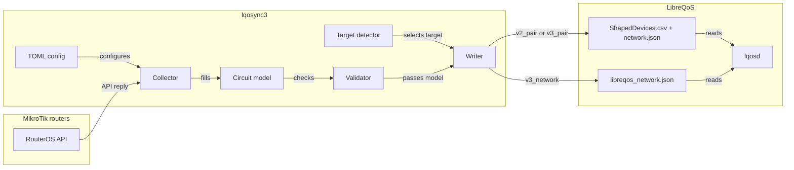
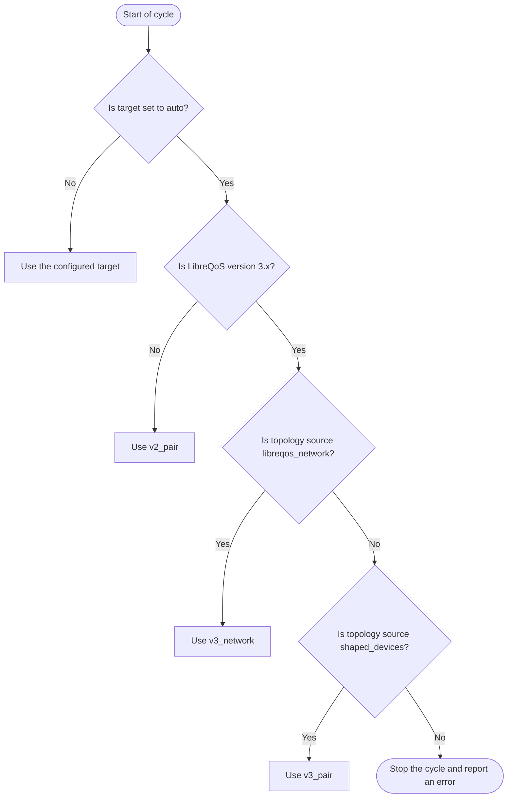
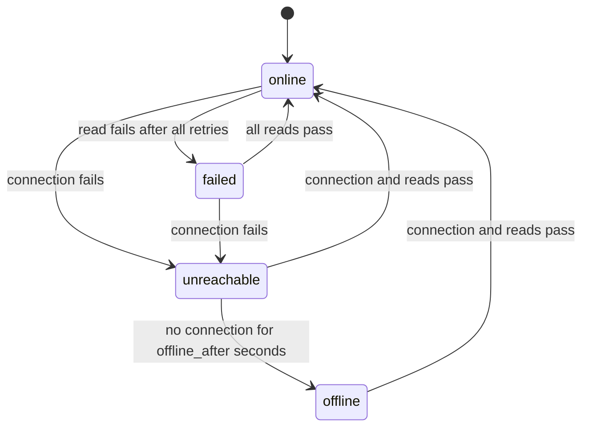

# Architecture

This document describes the parts of LQoSync3, the data flow, and the performance rules.
The decision for this design is [ADR-0001](../brain/20-decisions/ADR-0001-one-model-many-writers.md).

## Overview



Caption: the data flow from the routers to the LibreQoS input files.

## Parts

| Part | Job |
|------|-----|
| Config loader | Reads `/etc/lqosync3/lqosync3.toml`. Rejects unknown keys. Reads secrets from files. |
| Collector | Opens one RouterOS API session for each router. Reads PPP secrets, PPP active sessions, PPP profiles, DHCP servers, DHCP leases, and Hotspot users. Sets the router state: `online`, `failed`, `unreachable`, or `offline`. |
| State store | Keeps `state_dir/state.json`: the circuit ID, device ID, and source type of each circuit, the nodes that the tool made, and the last good rows of each router. The first run reads the IDs from the live `ShapedDevices.csv`. |
| Circuit model | Holds circuits, devices, nodes, and rates. Uses sorted maps (`BTreeMap`), so the output order is stable. |
| Speed rules | Converts RouterOS rate strings, profile names, and comments to Mbps. Applies factors, minimums, and backstop caps. |
| Topology builder | Builds the node tree from `network.mode` (six modes from `updatecsv.py`). |
| Validator | Rejects a duplicate IP, a duplicate circuit ID, a missing parent, a commit rate above the ceiling rate, and a duplicate node name. |
| Target detector | Reads the LibreQoS package version and the v3 `[topology]` section. Selects `v2_pair`, `v3_pair`, or `v3_network`. |
| Writers | One writer for each target. Each writer converts the same model to its file format. |
| Applier | Compares the content hash with the last applied hash. Writes files atomically. Starts the reload for `v2_pair`. Checks the v3 runtime status for v3 targets. |
| Notifier | Sends Telegram messages (optional). |

## Target selection



Caption: how `target = "auto"` selects the output format.

If the v3 topology source is a built-in integration (for example `uisp` or `splynx`), the tool stops. It does not write files that a different source owns.

## Router state

A failed router and an offline router are different. A failed router keeps its subscribers. An offline router loses its subscribers after `router_access.offline_after` seconds.
The decision is [ADR-0003](../brain/20-decisions/ADR-0003-router-failed-vs-offline.md). The settings are in [CONFIGURATION.md](CONFIGURATION.md#router-state).



Caption: the router states. In `failed` and `unreachable`, the tool keeps the last good rows. In `offline`, it applies `offline_action`.

The tool removes inactive subscribers only from routers in the `online` state. The rows of all other routers stay the same, except for `offline` with `offline_action = "remove"`.

### Change detection

The tool polls each router at the scan interval. A subscriber that is not in the active list is not present. Refer to [Subscriber presence](CONFIGURATION.md#subscriber-presence).
A later version can use the RouterOS API `listen` command, for example `/ppp/active/listen`. With `listen`, the router sends each change at once, and a removed item has `.dead=yes`.
`mikrotik-rs` 0.7.0 supports streamed replies and cancel. A test on a router is necessary before this design uses `listen`. A full poll must stay as a periodic check.

## Network modes

The tool keeps the six network modes of `updatecsv.py`.

| Mode | Tree |
|------|------|
| `grouped_router_root` | The router is the root. PPP, DHCP, Hotspot, and plan nodes are children of the router. |
| `flat_router_root` | The router is the root. Clients connect directly to the router root. |
| `flat_global_root` | One global root. Clients from all routers connect directly to it. |
| `no_parent` | The `Parent Node` field is empty. The tool does not change the tree. |
| `root_promotion` | Each PPP, DHCP, Hotspot, and plan node is a top-level root. |
| `flat_promotion` | Each device is its own top-level root. |

LibreQoS v3 uses `topology.compile_mode`. Only `full` shapes circuits under the node tree. The modes `flat`, `ap_only`, and `ap_site` change or ignore the tree. The tool shows a warning if the tree mode needs `full` and LibreQoS uses a different value.

## v3 differences that the writers handle

| Item | v2 pair | v3 network |
|------|---------|------------|
| Node type `plan` | Accepted | Not accepted. The writer uses `node`. |
| Node ID | `id` key in each node (2.2 and v3 read it) | `id` field. The same stable ID in both targets. Refer to [ADR-0005](../brain/20-decisions/ADR-0005-topology-follows-v3.md). |
| CSV columns | 14 (`Parent Node ID`) | 15 for `v3_pair` (`Parent Node ID`, `Anchor Node ID`) |
| Rate floor | max >= 0.2, min >= 0.1 | Same |
| Device comment | Kept | Not kept by the v3 compiler. |
| Duplicate IP in two circuits | Rejected by LibreQoS validation | Not rejected by the v3 compiler. The tool must reject it. |
| Duplicate node name | Rejected | Accepted. The tool rejects it, so that both targets stay the same. |
| Circuit without a parent | Accepted (`no_parent` mode) | Not accepted. `check` fails for `no_parent` with `v3_network`. Use `v3_pair`. |
| Reload | `LibreQoS.py --updateonly` | No command. `lqosd` watches the file. |

## Performance rules

The slow parts are the router API calls and the LibreQoS reload. The circuit calculation is small.
These rules apply:

1. Poll all routers at the same time. Use one `tokio` task for each router.
2. Keep each API session open between cycles. Open a new session only after an error.
3. Set a timeout on each API call (`router_access.api_timeout`). A slow router must not stop the other routers. After a timeout, open a new session and try again (`read_retries`).
4. Compile each regular expression one time at start.
5. Make a stable output. Sort the circuits, devices, and nodes.
6. Calculate a SHA-256 hash of each output file. If the hash did not change, do not write the file and do not reload.
7. Write each file to a temporary file in the same directory. Then rename the file. The `lqosd` watcher does not accept a symbolic link.
8. Use the active scan interval after a change. Use the idle interval when there is no change.

## Crate layout (proposed)

```text
lqosync3/
  Cargo.toml
  src/
    main.rs        CLI: check, detect, once, run
    config.rs      TOML types and secret files
    collector.rs   RouterOS API reads (mikrotik-rs)
    speed.rs       rate parsing and speed rules
    model.rs       circuits, devices, nodes
    topology.rs    the six network modes
    validate.rs    model checks
    detect.rs      LibreQoS version and v3 topology source
    writer/
      pair.rs      ShapedDevices.csv + network.json
      network.rs   libreqos_network.json schema 2
    state.rs       circuit IDs, generated nodes, last good rows
    apply.rs       hash, atomic write, reload, status check
    notify.rs      Telegram
  tests/
```

The crate is at the root of the branch `lqosync3` of `https://github.com/p33ckab00/LQoSync.git`. The branch has no shared history with the other branches. The crate does not use code from `v3/` or from the other branches.
