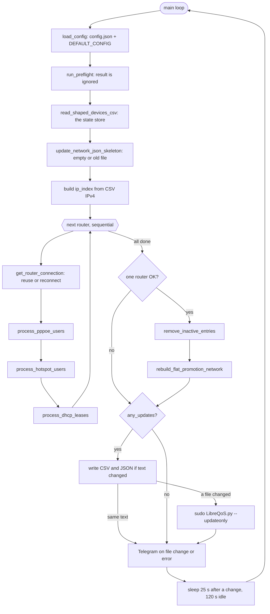

Sections

1. [The cycle](#cycle)
2. [Section map](#map)
3. [State store](#state)
4. [Circuit sources](#sources)
5. [Speed rules](#speeds)
6. [Network modes](#modes)
7. [Output contract](#contract)
8. [Defects and risks](#defects)
9. [Config surface](#config)
10. [Rewrite checklist](#rewrite)

/opt/libreqos/src/updatecsv.py · read in full on 2026-10-31 · input for the Rust rewrite

# Anatomy of `updatecsv.py`

This page takes the Python sync service apart, function by function. It shows what each part does, which behavior the Rust tool must copy, and which behavior it must fix. The live figures come from the production `config.json`, `ShapedDevices.csv`, and `network.json` on this shaper.

Lines

1,815

Size

71.4 KB

Functions

67

Third-party deps

routeros_api

Live mode

root_promotion

Live output

27 circuits · 5 nodes

Live routers

1 · API 8728

Unit

root · Restart=always

## The cycle run_one_cycle · L1645

The service is one endless loop in `main()`. Each pass reloads `config.json`, runs one cycle, sends Telegram if needed, and sleeps. All routers are read one after the other, in config order.



### Timing

Sleep is `scan_interval_active` (25 s) when any row or node changed in memory. Otherwise it is `scan_interval_idle` (120 s). The choice uses the in-memory flag, not the file-changed flag.

### Errors

An exception in the loop sends a Telegram alert and sleeps `error_retry_interval` (30 s). A router exception drops that router's session. systemd restarts the process after 10 s if it exits.

### Sessions

One API session per router stays open between cycles. A call to `/system/identity` proves that it is alive. A failed connect retries 3 times, with a 3 s pause.

## Section map 18 blocks

The file uses `# =====` banners. This table lists each block, its job, and the Rust module from `docs/ARCHITECTURE.md` that takes the job.

| Lines | Block | Key functions | Job | Rust module |
| --- | --- | --- | --- | --- |
| 1–54 | Header | `FIELDNAMES` | Docstring with the six modes. Imports. The 13 CSV columns. | `writer/pair.rs` |
| 56–119 | Defaults | `DEFAULT_CONFIG` | Every default value. Merged under `config.json`. | `config.rs` |
| 123–130 | Regex | `RE_PIPE` `RE_PAIR` `RE_SINGLE` `RE_UNIT` `RE_PLAN_NAME` | Speed and name patterns, compiled once. | `speed.rs` |
| 133–235 | Generic helpers | `deep_merge` `load_config` `generate_short_id` `write_text_file_if_changed` `render_network_json` | Config merge with legacy keys. Random IDs. Write only when text differs. | `config.rs`, `apply.rs` |
| 238–303 | Reporting | `new_report` `record_*` | A dict per cycle: added, updated, removed, duplicates, errors, computations, node updates. | `model.rs` (report type) |
| 306–361 | CSV files | `read_shaped_devices_csv` `render_shaped_devices_csv` | Load rows keyed by Circuit Name. Render sorted rows. | `writer/pair.rs` |
| 364–562 | Telegram | `telegram_send` `build_telegram_message` | HTML message, split at 3,900 chars, POST to the Bot API. | `notify.rs` |
| 565–614 | Preflight | `run_preflight` | Routers set, paths writable, command found, mode valid, Telegram keys set. | `main.rs check` |
| 617–687 | MikroTik helpers | `connect_to_router` `get_router_connection` `get_resource_data` | Session pool, reuse, and reads. Read errors return an empty list. | `collector.rs` |
| 690–781 | Bandwidth helpers | `convert_to_mbps` `parse_rate_limit` `parse_comment_bandwidth` `calculate_user_min_max` `get_backstop_cap` | Rate parsing, min and max, backstop caps. | `speed.rs` |
| 784–982 | Network mode helpers | `ensure_root_node` `parent_for_client` `network_children_for_grouped` `rebuild_flat_promotion_network` | Roots, parents, and where group nodes go in each mode. | `topology.rs` |
| 985–1029 | Entry helpers | `create_new_entry` `update_entry_values` `check_duplicate_ip` | New row with random IDs. String diff of fields. Duplicate IP check. | `model.rs`, `validate.rs` |
| 1032–1066 | PPP profile cache | `preload_ppp_profiles` | Speed per profile: comment, rate-limit, name suffix, default. | `speed.rs` |
| 1069–1266 | PPPoE | `process_pppoe_users` | Circuits from active sessions with a local secret. PPP group nodes. | `collector.rs` + `topology.rs` |
| 1269–1369 | Hotspot | `process_hotspot_users` | Circuits from active Hotspot users. One `HS-` node. | `collector.rs` + `topology.rs` |
| 1372–1585 | DHCP | `process_dhcp_leases` | Circuits from leases, per server. `per_site` and `per_plan` nodes. | `collector.rs` + `topology.rs` |
| 1588–1639 | Cleanup and LibreQoS | `remove_inactive_entries` `execute_libreqos_update` | Drop rows not seen this cycle. Run the reload. | `model.rs`, `apply.rs` |
| 1642–1815 | Main loop | `run_one_cycle` `should_send_telegram` `main` | Cycle order, file write, reload, sleep. | `main.rs run` |

There is a gap: no block selects a LibreQoS version or format. The Rust tool adds `detect.rs` and `writer/network.rs` for that.

## State store ShapedDevices.csv is the database

The script has no state file. Each cycle reads `ShapedDevices.csv` into memory, changes the rows, and writes the file back. The CSV holds the only copy of each circuit's IDs and type.

### How rows are kept

- The row key is **Circuit Name** (the script calls it `code`). Circuit ID is not the key.
- **Circuit ID** and **Device ID** are 8 random chars from `A–Z 0–9`. The script makes them when a code first appears. It does not check for a collision.
- A removed subscriber that returns gets new random IDs.
- The **Comment** column is the type tag: `PPP`, `HS`, `DHCP`, or the DHCP host name.
- A row with Comment `static` (any case) is never removed. Operators add these by hand.

### How network.json is kept

- With `preserve_network_config = false` (live), the script starts from an empty object each cycle and builds every node again.
- With `true`, it reads the old file and edits it. It deletes stale nodes by name pattern, for example `*-<router>`.
- Node rates are compared as whole objects. A difference is recorded as a node update.

### What this means for the Rust tool

The `v3_network` output has no Comment column, and v3 needs stable IDs. Keep a state file in `state_dir`: code to circuit ID, device ID, source type, and static flag. On the first run, seed it from the live CSV, so that the 27 current IDs stay the same.

## Circuit sources three processors

Each processor turns router rows into circuits. The code is also the Circuit Name. MAC values in codes have no colons and are upper case. The MAC column keeps the router form.

| Source | RouterOS paths | Row filter | Circuit Name | Device Name | Comment written | Speed from |
| --- | --- | --- | --- | --- | --- | --- |
| PPPoE | `/ppp/secret` `/ppp/active` `/ppp/profile` | Name is in both active and secrets. Secret is not `disabled` and not `inactive`. | `<username>` | username | `PPP` | Six-step chain (below) |
| Hotspot | `/ip/hotspot/active` | Needs a MAC when `include_mac`, or else a user name. | `HS-<MAC>` or `HS-<user>` | user, or MAC | `HS` | Fixed per router: `download_limit_mbps` |
| DHCP `per_site` live | `/ip/dhcp-server/lease` | Lease `server` matches. Has MAC. Has `active-address` or `address`. No status check. | `DHCP-<host-name>` or `DHCP-<MAC>` | host name, or MAC | host name, or `DHCP` | Fixed per server: `default_plan_down_mbps` |
| DHCP `per_plan` | `/ip/dhcp-server/lease` | Same, and the lease comment must hold a speed. Else the lease is skipped. | `DHCP-<name before \|>`, host name, or MAC | same name, or MAC | name, or `DHCP` | Lease comment |

A duplicate IP check runs only when a code is new. The new circuit is skipped, but its code still counts as active for that cycle.

## Speed rules L690–781, L1035

### Units

`convert_to_mbps` reads `k` as ×0.001, `M` as ×1, `G` as ×1000. A number **with no unit is Mbps**. RouterOS reads a number with no unit as bit/s.

The comment patterns accept only `M`: `|25M/5M`, then `25M/5M`, then `25M` (same both ways). A comment like `1G` does not match.

### Direction decision

`parse_rate_limit("A/B …")` reads A as download and B as upload. RouterOS writes `rate-limit` as rx/tx from the router side, so A is the client's upload. An asymmetric profile rate comes out swapped.

Comments use the operator's download/upload order. The live rates are symmetric, so the live output shows no error.

### PPPoE chain, first match wins

1. Secret comment, through `parse_comment_bandwidth`
2. Active session comment
3. Profile comment (from the profile cache)
4. Profile `rate-limit`, first token only, A/B as download/upload
5. Profile name, trailing number: `Gold-25M` gives 25. **Trap:** `Tier-15M-WAN1` gives 1, not 15. The live rows get 50 from an earlier step, so this trap is not active now.
6. `pppoe_default_rate` (`10M/10M`). A profile name that is not in the cache also falls here.

### Per-circuit rate

max = max(round(base, 3), safe_min_mbps) min = max(round(base × min_rate_percentage, 3), safe_min_mbps) live: base 50 → max 50.0, min 5.0 (min_rate_percentage 0.1, safe_min_mbps 0.128)

### Group node rate

Each group rate is a sum or a count, times a factor. Then the backstop cap (`download_mbps × multiplier`) applies, then the `safe_min_mbps` floor. The table checks each formula against the live `network.json`.

| Node | Type | Formula | Cap | Live check |
| --- | --- | --- | --- | --- |
| `PPP-<router>` | plan | Σ base × `pppoe_aggregate_factor` | pppoe | not used live |
| `<profile>-<router>` | plan | Σ base of the profile × `pppoe_aggregate_factor` | pppoe | 9 × 50 × 0.35 = 157.5 ✓ 12 × 50 × 0.35 = 210.0 ✓ |
| `HS-<router>` | site | count × per-client rate × factor | hotspot | Hotspot off live |
| `DHCP-<server>-<router>` | site | lease count × server rate × server factor | dhcp | LAN: 4 × 50 × 1.0 = 200.0 ✓ a server with 0 leases: no node ✓ |
| `PLAN-DHCP-<label>-<router>` | plan | Σ base × server factor. Label is `int()` of the rate. | dhcp | not used live |
| root (`<router>` or `root_name`) | `root_type` | fixed `root_download_mbps` | — | no root in root_promotion |

The `get_plan_factors(profile)` function ignores the profile. All PPP plan nodes use the same factor.

## Network modes six modes

The mode controls three things: the root node, where the group nodes go, and the Parent Node of each circuit.

| Mode | Root node | Group nodes | Circuit Parent Node | network.json result |
| --- | --- | --- | --- | --- |
| `grouped_router_root` | `<router>` | Children of the router root | Its group node | Root → groups |
| `flat_router_root` | `<router>` | None | `<router>` | Roots with empty children |
| `flat_global_root` | `root_name` or `LibreQoS-Network` | None | The global root | One root |
| `no_parent` | None | None | Empty | `{}`, or the old file when preserved |
| `root_promotion` live | None | Top level, each one its own HTB root | Its group node | 5 top-level nodes |
| `flat_promotion` | None | None | Empty | One `client` node per circuit, at top level |

In `flat_promotion`, the processors write each client node with the raw base rate. Then `rebuild_flat_promotion_network` writes it again from the CSV max. The second write wins.

## Output contract for a byte-equal shadow compare

In `shadow` mode the Rust tool must write the same bytes as the Python service. These details decide that.

### ShapedDevices.csv

- Header and 13 columns in `FIELDNAMES` order. LF line ends. Minimal quoting.
- Rows sorted by Parent Node, Circuit Name, Device Name, IPv4, MAC. Plain string order.
- Rates are Python `str(float)`: `50.0`, `5.0`, `0.128`, `157.5`.
- IPv6 is always empty.

### network.json

- `json.dumps(indent=4, sort_keys=True, ensure_ascii=False)` plus a final newline.
- Keys sorted at every level. Rates are floats: `620.0`.
- Each node: `children`, `downloadBandwidthMbps`, `type`, `uploadBandwidthMbps`.

### Rust traps

- `format!("{}", 50.0_f64)` gives `50`. Python gives `50.0`. Use `{:?}` or a small formatter, and test it against Python output.
- `serde_json` sorts keys only with its default `BTreeMap` map. Do not turn on `preserve_order`. Use `PrettyFormatter::with_indent(b" ")`.
- Set the `csv` writer terminator to `\n` explicitly.

```
// shape of one live node (network.json)
"Tier-15M-WAN1-<router>": {
    "children": {},
    "downloadBandwidthMbps": 157.5,
    "type": "plan",
    "uploadBandwidthMbps": 157.5
}
```

## Defects and risks ranked

Each row is a behavior found in the code. The last column gives the rewrite action. Rows marked decision change live output, so the operator must agree first.

| Level | Finding | Line | Rewrite |
| --- | --- | --- | --- |
| critical | One router fails, another succeeds: cleanup removes every subscriber of the failed router. | 1703 | Track active codes per router. Keep the last good rows of a failed router. |
| critical | `get_resource_data` returns `[]` on a read error. A failed `/ppp/active` read looks like zero users, so all of them are removed. | 685 | A read error marks the router as failed for the cycle. |
| high | No timeout on API calls, and routers are read in sequence. One hung router stops the whole cycle. | 620 | A timeout on each call. One task per router. |
| high | Files are written in place (`open("w")`). A reader can see a part-written file. | 217 | Temp file in the same directory, then rename. |
| high | The preflight result is ignored. The cycle continues when checks fail. | 1648 | A failed check stops the cycle. |
| high | Plain API login on port 8728. The router password and the Telegram token are in plain `config.json`. | 628 | TLS on 8729. Secret files with mode `0600`. |
| high decision | Rate direction is swapped for asymmetric `rate-limit`, and a number with no unit is Mbps. | 706 | Operator selects the rule. Open item in HANDOFF. |
| medium | The duplicate IP check runs only for new codes. An existing circuit can move to an IP that another circuit uses. | 1148 | Validator checks all circuits after the build. |
| medium | Random IDs with no collision check. New IDs after a subscriber returns. | 196 | IDs in the state file. Same code, same ID. |
| medium | The Comment column has two jobs: type tag and DHCP host name. A host named `static` is never removed. | 1458 | Source type in the model. Comment only for display. |
| medium | The profile name rule reads the last number: `Tier-15M-WAN1` gives 1 Mbps. | 737 | Read the number before `M`, or drop the rule. |
| medium decision | DHCP leases are not filtered by status. An offline static lease with an address counts as active. | 1417 | Operator selects: keep, or only `status=bound`. |
| medium | PPP sessions with no local secret (RADIUS) are skipped with no log line. | 1104 | Log a count of skipped sessions. |
| medium | With `preserve_network_config = true`, the cleanup by name pattern can delete nodes that an operator added by hand. | 1186 | Delete only nodes that the tool made, from the state file. |
| low | The DHCP `per_site` count includes leases skipped as duplicates. The `per_plan` label truncates, so 2.5M and 2M share a node. | 1474 | Count only kept circuits. Keep the label rule for compatibility. |
| low | When two new circuits have the same IP, the winner depends on set order, and that order changes after a restart. | 1104 | Sort codes before the check. |
| low | `config.json` path is relative to the working directory. | 38 | Fixed path `/etc/lqosync3/lqosync3.toml`. |
| low | Dead code: `cleanup_flat_promotion_nodes`, `previous_flat_promotion_codes`, `started_notice_sent`, the PPP MAC fallback, `notify_on_start`, `notify_on_no_changes`. | 965 | Do not port. |

## Config surface keys the code reads

The code reads some keys that `docs/CONFIGURATION.md` does not show. The TOML schema and `import-json` must cover them.

### Missing from the TOML doc

- `routers[].dhcp.enabled`. DHCP is off without it. The doc example has DHCP servers but no switch.
- DHCP server `mode = "per_plan"`.
- DHCP server `download_limit_mbps` and `upload_limit_mbps`. They have priority over `default_plan_*_mbps`.
- `telegram.parse_mode`. Always `HTML` in practice.

### Legacy keys for import-json only

- Root `preserve_network_config`, `flat_network`, `no_parent`.
- `dhcp.dhcp_server` list with `dhcp.download_limit_mbps` and `upload_limit_mbps`.
- Code fallback for `root_download_mbps` is 620, but the default is 640. Live sets 620.
- Drop: `notify_on_start`, `notify_on_no_changes`. The code does not use them.

## Rewrite checklist from scratch, same output

### keep Copy exactly

- Six modes, node names, and node types.
- Circuit Name rules for each source.
- Speed chain order and comment patterns.
- Min, max, group, and cap formulas.
- CSV columns, sort order, and float text.
- network.json format and key order.
- Rows with Comment `static` stay.
- Write and reload only when text changes.
- Open session reuse between cycles.
- Telegram only on file change or error.
- 25 s / 120 s / 30 s timing.

### change Fix in the rewrite

- Failed router keeps its last good rows.
- Read error means router failed.
- Timeout per call. Parallel routers.
- Atomic write by rename.
- Preflight failure stops the cycle.
- Duplicate IP check on all circuits.
- IDs and source type in a state file, seeded from the live CSV.
- TLS and secret files.
- Target detector and the `v3_network` writer.

### decide Ask the operator

- Rate direction and unitless numbers.
- DHCP lease status filter.
- Profile name suffix rule: fix or drop.
- Keep `sudo`? The service already runs as root.

Each decision changes live output. Shadow compare shows the difference before the cutover.

Source: `/opt/libreqos/src/updatecsv.py` (1,815 lines, read in full). Live values: `config.json`, `ShapedDevices.csv`, and `network.json` on the production shaper, 2026-10-31. Credentials, addresses, MACs, and host names are left out.