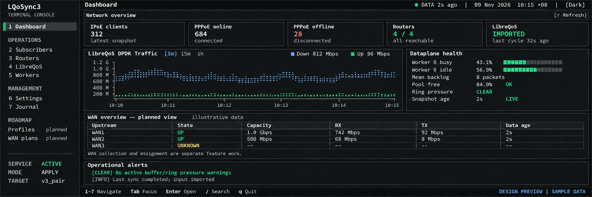
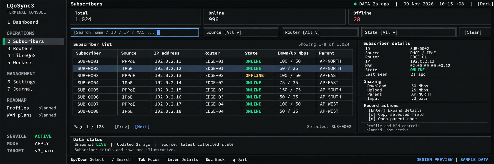
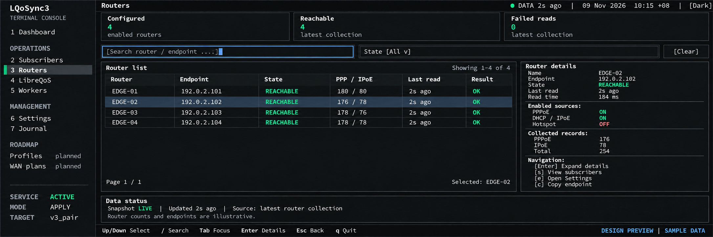
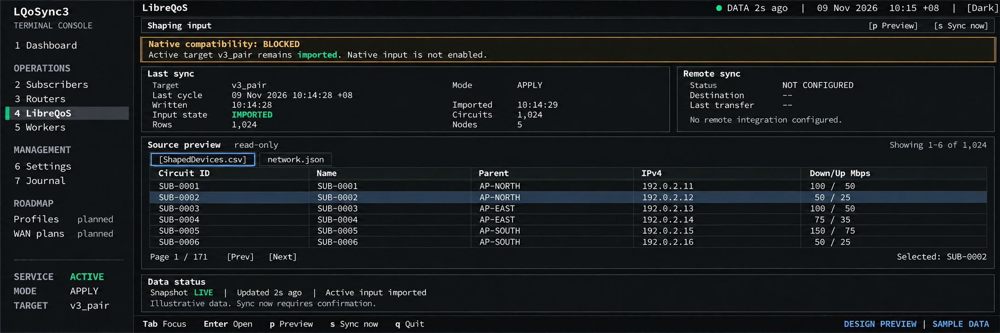
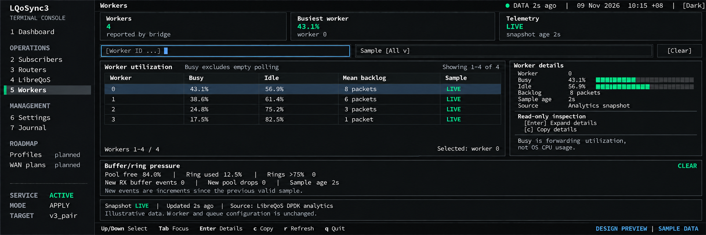
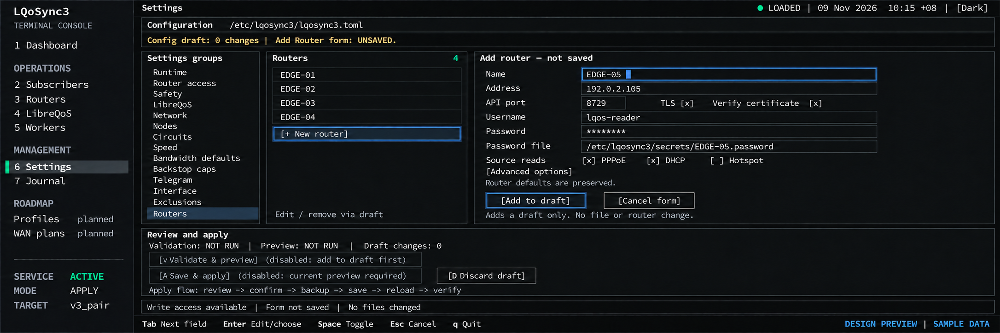
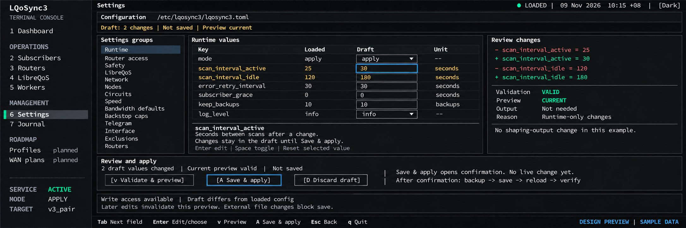
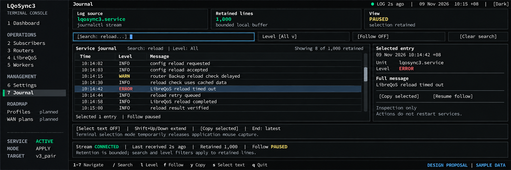

# LQoSync3 TUI visual contract

Date: 2026-11-09. Time zone: Asia/Shanghai.
Scope: approved screenshot baseline and all seven implemented TUI screen bodies. Local verification is complete; deployment is separate.

## Owner decisions and reference order

The owner approved Dashboard, Subscribers, Routers, LibreQoS, Workers, and both Settings views in this conversation.
The owner then selected `LibreQoS DPDK Traffic` as the Dashboard chart title and data source.
The owner requires implementation to follow these screenshots.

Use the stored screenshots as the visual baseline. Preserve their shell, proportions, panel order, spacing, colors, and text hierarchy.
Do not replace the approved composition with a different dashboard during implementation.
Document any necessary deviation and get the owner's approval before changing the visual baseline.

| Screen | State | Canonical reference |
|---|---|---|
| Dashboard | Approved composition, with the owner-selected DPDK title update | [Dashboard v2](mockups/dashboard-dpdk-v2.png) |
| Subscribers | Approved composition | [Subscribers v1](mockups/subscribers-approved-v1.png) |
| Routers | Approved composition; identical to the reviewed proposal | [Routers v1](mockups/routers-approved-v1.png) |
| LibreQoS | Approved composition; identical to the reviewed proposal | [LibreQoS v1](mockups/libreqos-approved-v1.png) |
| Workers | Approved composition; identical to the reviewed proposal | [Workers v1](mockups/workers-approved-v1.png) |
| Settings | Approved: Add Router and Edit Values / Review Changes | [Add Router](mockups/settings-add-router-approved-v1.png), [Edit Values](mockups/settings-values-approved-v1.png) |
| Journal | Approved by owner | [Journal v1](mockups/journal-proposal-v1.png) |
| Original Dashboard | Historical approval evidence; v2 supersedes its chart title | [Dashboard v1](mockups/dashboard-approved-v1.png) |

The PNG files are imagegen concept mockups, not screenshots of an implemented application.
The [generation record](PROMPTS.md) preserves the tool, references, and final prompts for this update.
All displayed records, values, timestamps, and online states are synthetic examples.
Implementations must read current backend data. They must never embed the example records as operational data.

LQoSync4 provides the design inspiration:

- [Visual system](https://github.com/p33ckab00/LQoSync/blob/b5284bd9fc4c3e8d7a35b8c6f24e2e4faf8709e8/docs/lqosync4/docs/UI_VISUAL_SYSTEM.md)
- [Routes and components](https://github.com/p33ckab00/LQoSync/blob/b5284bd9fc4c3e8d7a35b8c6f24e2e4faf8709e8/docs/lqosync4/docs/ROUTES_AND_COMPONENTS.md)

This contract adapts the approved appearance for Ratatui. It does not change the separate LQoSync4 web product specification.
Earlier TUI documents describe current behavior and historical styling. This contract defines the new approved appearance.
Preserve their validation, secret controls, read-only restrictions, and action-result checks when implementing the redesign.

## Implementation status

The first slice adds the wide-terminal sidebar and top bar. Dashboard opens first.
Keys 1 through 7 and sidebar clicks use the same navigation actions.
The theme control changes the current view. Settings still controls the saved theme.
Dialogs and active inputs block background navigation. A resize clears obsolete mouse targets.
Terminals below 140 columns or 28 rows retain the compact header and body layout.
The minimum supported terminal remains 80 columns by 24 rows.

All seven screen bodies now use the approved panel order and shared visual roles.
Enabled controls accept clicks. Overflowing panels support wheel input and scrollbar track clicks and thumb drags.
Settings retains the existing draft, validation, preview, confirmation, conflict, backup, secret, and reload-result checks.
Journal retains original-text copy and terminal selection. Tab moves between controls within adapted screens.
Keys 1 through 7 select pages. Dashboard and Network also retain Tab route navigation.

Missing evidence remains unknown or unavailable. Subscriber states now use cycle collection evidence; missing, failed, and expired evidence remains unknown/stale.
Router reachability describes the latest collection result, not a new connection test.
The wide header uses `LOG AGE` on Journal and `SYNC AGE` elsewhere. Panel status labels show each source's freshness.
The DPDK chart uses actual aggregate counters and bounded service-owned history. Deploy the new monitor to populate the live cache.
WAN plans, Profiles, remote sync, and unavailable native row counts retain their explicit planned/unknown labels.

Checks: 552 tests pass, zero fail, seven manual tests are ignored. All-target Clippy, formatting, and the build pass.
The final exporter covers 63 frames: seven routes, three themes, and 80x24, 120x40, and 160x48 viewports.
Real terminal captures use isolated synthetic sources. Writable Settings images use actual Ratatui fixture frames.
See the [capture index](captures/README.md) for evidence, reproduction steps, and limits.
The terminal composition follows the concepts. Font metrics, cell borders, and evidence-dependent labels prevent pixel identity.
Production deployment and a privileged Settings terminal session remain separate operational checks.

## Shared shell

Use a full-screen terminal with monospace text and thin rectangular borders.
The left sidebar occupies approximately 13.5 percent of the wide reference image.
The main area contains a slim top bar, screen content, and a keyboard footer.
The selected navigation row uses a charcoal fill and a narrow green marker.

Keep the reference navigation order and groups:

```text
LQoSync3
TERMINAL CONSOLE

1 Dashboard
OPERATIONS
2 Subscribers
3 Routers
4 LibreQoS
5 Workers
MANAGEMENT
6 Settings
7 Journal
ROADMAP
Profiles   planned
WAN plans  planned
```

The sidebar bottom shows service state, mode, and target.
The top bar shows the page name, data age, exact local time with UTC offset, and theme.
Each footer shows the keys that apply to its screen.
Roadmap labels do not activate unfinished backend workflows.

| Token | Color |
|---|---|
| Canvas | `#0b0c0e` |
| Sidebar | `#141517` |
| Panel | `#17191b` |
| Border | `#2b2e32` |
| Text | `#f1f3f5` |
| Muted text | `#b2b8bf` |
| Healthy | `#2bd391` |
| Warning | `#ffd077` |
| Critical | `#ff858a` |
| Accent and focus | `#80aaff` |

Use explicit state words with color. Keep the selected table row and active keyboard focus visible.
Preserve light and monochrome usability. The approved screenshots define the dark theme.
Terminal font metrics can change raster pixels. Match the composition in terminal cells and compare captures at the same viewport.

## Mouse interaction contract

The owner requires mouse interaction across all screens, including Settings and router creation.
Every visible, enabled action must support a primary-button click as well as its keyboard path.
This requirement supplements the approved screenshots. Keep their composition and existing image assets unchanged.

### Clicks and editing

| Area | Required mouse behavior |
|---|---|
| Shared shell | Click a sidebar item to navigate. Click the theme control to choose a theme. |
| Dashboard | Click time-window tabs, refresh, and enabled detail/navigation actions. |
| Subscribers, Routers, Workers | Click a row to select it and update its details. Click filters, choices, Clear, page controls, and detail/copy actions. |
| LibreQoS | Click source-file tabs, preview rows, page controls, Preview, and Sync now. Retain sync confirmation. |
| Settings navigation | Click a group, router, Add Router, or supported advanced section to open it. |
| Settings values | Click an input to focus its editor. Click a choice to open it and click an option to select it. Click a checkbox or its label to toggle it. |
| Settings actions | Click Add to draft, Cancel form, Validate & preview, Save & apply, Discard, and supported edit/remove actions. |
| Dialogs | Click enabled confirm/cancel controls and choices. Only the top dialog receives input while it is open. |
| Journal | Click entries and enabled filters, follow, selection, and copy controls. Preserve the existing text-selection mode. |
| Action hints | Any footer hint presented as an action must have a click target that invokes the same command. |

Visible disabled controls remain disabled by mouse. Explain the same prerequisite or restriction as the keyboard path.
Static labels do not become commands. Planned features remain visibly inactive.
A click must not bypass validation, current-preview checks, read-only mode, conflict checks, or confirmation.
Mouse and keyboard input must invoke the same action logic and produce the same result states.

Show keyboard focus and selection distinctly. Keep draft values and masked secrets when focus moves.
Do not require a double-click for a primary action. Selection alone must not apply changes or start a sync.
Ignore clicks outside active controls. A dialog must prevent clicks from activating the covered screen.

### Wheel and scrollbar behavior

Support mouse-wheel scrolling in every panel whose content exceeds its viewport.
This includes tables, group/router lists, detail panels, settings forms, choices, dialogs, diffs, previews, and Journal.
Route wheel input to the scrollable region under the pointer. A wheel event must not scroll an unrelated panel.
If a dialog is open, route input only within that dialog.

Show a scrollbar when content overflows. Keep it at the panel edge within the approved panel geometry.
The thumb position and size must describe the current offset and visible share of the content.
Click the track to move toward that position. Drag the thumb to change the offset continuously.
Support any displayed scrollbar arrows with clicks. Wheel scrolling must work over the content and its scrollbar.
Hide or disable the scrollbar when all content fits. Clamp all offsets to valid content bounds.

Support horizontal scrolling when a wide table, preview, or diff needs it.
Provide a clickable and draggable horizontal scrollbar when shown. Support horizontal wheel events where the terminal reports them.
Keep keyboard alternatives for terminals that do not report horizontal wheel events.
Scrolling must preserve fixed headers, access to actions, and selected-record identity.
Paging and scrolling remain distinct. Page controls select a page; wheel and thumb movement scroll its viewport.
Wheel input must not silently edit a configuration value or select a different choice.

Recalculate click targets and scroll ranges after a draw, resize, filter, page change, or content update.
Do not retain stale coordinates for hidden controls. Keep an active thumb drag bound to its original panel until release or cancellation.
Handle release outside the panel without leaving a stuck drag. Cancel a drag if its panel closes or the layout becomes invalid.

### Verification and terminal support

The current code enables crossterm mouse capture in `src/tui/mod.rs` and handles some mouse actions in `src/tui/app.rs`.
This is a reusable foundation, not proof that every redesigned control or scrollbar already works.
Use terminal mouse reporting for clicks, wheel events, and drags. Preserve keyboard operation and explicit terminal text-selection mode.
When text-selection mode releases mouse capture, show that state and a keyboard route back to application mouse control.

Before accepting implementation, exercise click-only navigation and editing through each screen.
Add a router draft, edit values, review, confirm or cancel, and inspect results using mouse controls with controlled fixtures.
Check disabled actions, read-only restrictions, stale previews, and dialogs against click-through and duplicate activation.
Check wheel, track clicks, and thumb drags at both ends of each overflowing panel, including resize and filter changes.
Verify independent panels, horizontal overflow, empty content, one-row content, and release outside a scrollbar.
Run real-terminal checks over SSH with mouse reporting enabled. Record terminal-specific limitations explicitly.
Screenshots establish appearance. Mouse behavior requires event-level tests and real-terminal verification during implementation.

## Dashboard



Preserve this vertical order:

1. `Network overview` row, with the refresh hint at the right.
2. Five summary cards: IPoE clients, PPPoE online, PPPoE offline, Routers, and LibreQoS.
3. Large `LibreQoS DPDK Traffic` chart at the left, with `Dataplane health` at the right.
4. Full-width `WAN overview — planned view` table.
5. Full-width `Operational alerts` panel.
6. Keyboard footer.

The chart uses blue for download and green for upload.
Keep the `5m`, `15m`, and `1h` controls, current rates, time axis, and rate units.
The title replaces `Traffic overview`. The owner approved no other Dashboard layout change in this update.

The health panel contains worker busy/idle, mean backlog, pool free capacity, ring pressure, and sample age.
Display the available worker set accurately. Do not hard-code worker 0 as the only possible worker.
The WAN panel remains visibly planned until its collector and read model exist.
The alerts panel must derive `CLEAR` from fresh evidence. Unavailable telemetry cannot imply a healthy state.

### DPDK traffic data contract

Extend the existing read-only analytics snapshot integration. Do not start a router scan during a draw.
The upstream snapshot exposes optional `actual` and `shaped` directional byte counters.
Check the installed producer's counter semantics before selecting and naming the plotted series.
Do not substitute LQoSync process network accounting, configured ceilings, or worker busy percentages for DPDK traffic.

Calculate each rate from the byte-counter difference and the corresponding producer-time difference:

```text
Mbps = delta_bytes * 8 / delta_seconds / 1_000_000
```

Require two valid samples before displaying a rate. Repeated producer timestamps must not generate a new rate.
Reset the baseline after a counter decrease, producer restart, read failure, or expired sample interval.

Show unknown values and chart gaps after invalid samples. Never draw a synthetic zero or a restart spike.
Preserve stale values with their age and state. Do not label stale data `LIVE`.

Store bounded, time-bucketed history for the selected windows. Enable a window only when the required history is available.
Retain history in the service process and publish it in the existing public telemetry cache. The worker cache now carries up to 1,801 samples over one hour. The service polls every two seconds.
History resets when the service restarts. Invalid intervals remain gaps; values do not interpolate across them.
Older caches without traffic history show unavailable data. The new monitor code must run before it can populate new history.

Use real aggregate counters, not a sum of a limited subscriber result page.
Keep packet direction and series provenance explicit. Do not combine `actual` and `shaped` into one undocumented total.

[Upstream snapshot contract](https://github.com/LibreQoE/LibreQoS/blob/9ebe29bc/rust/libreqos_dpdk/analytics_ipc/src/lib.rs).

### Dashboard runtime review

Actual terminal capture: [Dashboard cycle collection](captures/dashboard-collection-v2.png). This uses synthetic fixture records in a real Zutty terminal.
The panel order, chart/health split, colors, and selected navigation follow the approved composition.
Terminal font and border placement change raster pixels. This capture does not claim pixel identity with the concept image.
PPPoE offline comes from known local account inventory. Missing account evidence stays unknown. The planned WAN panel contains no invented production records.
The sidebar service state reflects the isolated fixture unit, which is inactive.

Click the time windows or use `w` to cycle windows with enough retained history.
Click Refresh or press `r` to wake the cached-data loader. Refresh never starts a sync cycle.
Use arrows, PageUp/PageDown, Home/End, or the mouse wheel for the compact body.
Operational alerts have independent wheel and scrollbar controls. Visible scrollbars accept track clicks and thumb drags.
The top bar retains truthful `SYNC AGE` for the last collection cycle.

## Subscribers



Keep three summary cards: Total, Online, and Offline.
Place search and Source, Router, and State filters directly below them, with a Clear action.
The main content uses a wide table at the left and the selected subscriber details at the right.

Keep the table columns: Subscriber, Source, IP address, Router, State, Down/Up Mbps, and Parent.
Preserve the selection highlight, page controls, selected-record label, and full identifier access.
The details panel groups identity, Shaping, and Record actions.
Keep the Data status panel above the keyboard footer.
Profile and WAN controls remain marked planned. Approval of this screen does not implement RouterOS writes.

Subscriber online evidence and freshness must come from the source record.
A record in a shaping file alone does not prove a current online session.

### Subscribers runtime review

Actual terminal capture: [Subscribers cycle collection](captures/subscribers-collection-v2.png), with isolated synthetic data.
The cards, filters, table/details split, selection, paging controls, and data-status strip follow the approved image.
Online/offline counts and row states remain unknown without current session evidence. Static shaping rows never imply online state.
The table builds only visible rows. Source and router choices update when collected metadata changes.
The collection cache refreshes with the existing sync cycle. It adds observed-only accounts to this view, without changing shaping inputs.
Local PPP and Hotspot inventory provides known offline accounts. Active sessions provide online state, including active RADIUS users.
DHCP rows show BOUND/UNBOUND lease state. Disabled sources show OFF; failed or expired evidence cannot claim online/offline.
The State filter also provides Bound, Unbound, Disabled, and Unknown (including stale).
Cards count known session/account states. The status strip gives collection age, lease counts, and disabled records.
The same five Dashboard cards remain; Hotspot active count appears in the Routers card note.

Click controls or use `s` for Source, `r` for Router, `t` for State, and Tab to move focus.
Use Enter on a focused filter, `e` or Enter from the table for expanded details, `n` for the parent, and `c` for copy.
Left/Right scroll the table columns. Details and the table have independent wheel and scrollbar controls.
The full identifier and all shaping fields remain available in expanded details.
Copy retains the bounded OSC 52 path and its unconfirmed result label.

## Routers



The owner approved this exact image. The approved asset is a byte-for-byte copy of the original proposal.
Preserve its panel geometry and labels. This approval does not authorize a different router-management layout.

Reuse the approved Subscribers shell, filters, table/detail composition, data-status panel, and keyboard footer.
Select `3 Routers` in the sidebar.
Show configured, reachable, and failed-read counts above the search and State filter.
The table shows router name, endpoint, state, PPP/IPoE record counts, last read, and result.
The selected router details show endpoint, collection state, enabled sources, and collection time.

Keep credentials out of both the table and the detail panel.
An `OFF` source describes configuration. It must not count as a failed router read.

The approved visual actions are Expand details, View subscribers, Open Settings, and Copy endpoint.
Connection management uses the implemented Settings workflow. Navigation actions preserve the current draft.
This screen does not add routing, assignment, or profile writes.
Router health describes the latest collection evidence. Stale evidence must remain distinct from a failed read.

Keep these details from the approved image:

- Three equal cards: Configured, Reachable, and Failed reads.
- Search by router or endpoint, then the State filter and Clear action.
- Router list at the left, with columns Router, Endpoint, State, PPP / IPoE, Last read, and Result.
- Blue selection across the entire row, with page and selected-router labels below the table.
- Router details at the right, grouped into identity, Enabled sources, Collected records, and Navigation.
- Full-width Data status panel above the keyboard footer.

### Routers runtime review

Actual terminal capture: [Routers cycle collection](captures/routers-collection-v2.png), with isolated synthetic data.
The cards, filters, list/details split, selection, source flags, paging, and status strip follow the approved composition.
Configured endpoints and source flags come from the loaded config. Reachable and failed counts describe the latest collection.
Config parsing occurs only when the config changes. Collection updates preserve selection and refresh cached result fields.
Use `/` for search, `t` for state, `x` for Clear, Tab for focus, and arrows/PageUp/PageDown for selection.
Use `d` for expanded details, `s` for router-filtered Subscribers, `e` for Settings, and `c` for the endpoint.
Clicks use these same actions. Table and details have independent wheel and scrollbar controls; Left/Right exposes table columns.
Copy includes the endpoint only. It does not include credentials or secret paths.

## LibreQoS



The owner approved this exact screenshot. The approved asset matches the original proposal byte for byte.
Preserve its panel geometry, labels, selected row, source tabs, and action placement.

Select `4 LibreQoS` in the approved sidebar. Keep the shared top bar, colors, borders, font, and keyboard footer.
Place the page actions above a persistent issue region. Below it, place Last sync and Remote sync cards side by side.
The lower main panel contains the source preview, file tabs, record table, and page controls.
Place a Data status panel above the keyboard footer.

The approved example shows `v3_pair` as the active target. Native compatibility has its own labeled state.
A blocked native probe must not imply failure of the active pair import or trigger a source switch.

Remote sync shows `NOT CONFIGURED` when no remote integration exists. Never invent a successful remote result.
The preview offers `ShapedDevices.csv` and `network.json` for pair input. Native input requires a separate applicable preview.

Distinguish candidate, written, import pending, imported, blocked, and failed results.
An action must show its actual result. A file write alone does not prove a successful import.

Preview is read-only. Sync now keeps the existing explicit confirmation and service-result checks.
Controls shown in this concept do not bypass current backend guards.

For native missing-parent issues, the persistent region must show affected circuit/row counts and access to their details.
Show that issue only when applicable to the native target. Keep last-known diagnostics with their time after a failed operation.

Clear a native issue only after a newer valid native result proves recovery.
The sample native compatibility notice is separate from a native missing-parent alert.
This screen has owner approval. Its runtime review follows below.

Keep these details from the approved image:

- `Shaping input` row, with Preview and Sync now actions at the right.
- Full-width native compatibility notice directly below that row.
- Last sync card at the left and Remote sync card at the right.
- Full-width read-only Source preview with ShapedDevices.csv and network.json tabs.
- Columns Circuit ID, Name, Parent, IPv4, and Down/Up Mbps.
- Blue selected row, page controls, and selected-circuit label below the table.
- Full-width Data status panel above the keyboard footer.

### LibreQoS runtime review

Actual terminal capture: [LibreQoS](captures/libreqos-v1.png), with isolated synthetic data.
The action row, compatibility notice, sync cards, source preview, selection, paging, and data-status strip follow the approved layout.
`IMPORTED` requires the service result `imported by LibreQoS`. A file write or native watcher does not imply successful import.
Unknown import timestamps remain unknown. The native probe never changes the active pair target.
Native missing-parent notices retain circuit diagnostics after failed reads. Row counts remain unknown when the producer supplies no count.
A newer ready native result with valid input and no parent alerts clears the notice.
The native file preview uses the original loaded native JSON; the compatibility-tree tab is labeled separately.
Use `p` for preview/back, `s` for guarded sync, Tab for source files, `i` for native issue details, and Left/Right for columns.
Mouse actions use the same gates. The source panel and compact body have wheel and interactive scrollbar controls.

## Workers



The owner approved this exact screenshot. The approved asset matches the original proposal byte for byte.
Preserve its cards, filters, table columns, selected row, detail groups, pressure panel, snapshot status, and footer.

Select `5 Workers` in the approved shell. Keep the shared palette, typography, borders, top bar, and keyboard footer.
Show summary cards for worker count, busiest worker percentage, and telemetry freshness.
Place the worker-ID and sample-state filters below the cards.
Use a worker table at the left and selected-worker details at the right.
Place full-width Buffer/ring pressure and Data status panels below them.

The table shows Worker, Busy, Idle, Mean backlog, and Sample.
The detail panel shows the selected ID, busy/idle bars, backlog in packets, age, and source.

Busy excludes empty receive polling. It is not the operating system CPU percentage.
Idle is the complement of busy. Do not add percentages across workers as a whole-system utilization figure.

Worker count and IDs must come from telemetry. The four rows in the approved example are illustrative.

The pressure panel shows pool free capacity, ring occupancy, rings above 75 percent, and new RX/pool events.
Use counter increments, not historical totals, for current event warnings.
A valid zero-ring topology shows `no rings`. Missing capacities or counters show unknown values.
Freshness refers to the analytics snapshot. It does not prove that each worker is healthy or has a recent individual rollup.

The screen is read-only. Navigation, copy, and refresh do not change worker count, queues, CPU assignments, or bridge state.
Unknown or stale data must never show an active `CLEAR` or `LIVE` verdict.
This screen has owner approval. Its runtime review follows below.

### Workers runtime review

Actual terminal capture: [Workers](captures/workers-v1.png), with isolated synthetic telemetry.
The cards, filters, utilization/detail split, pressure panel, snapshot strip, and bars follow the approved composition.
Live/Stale filters update on timer expiry even when no loader event arrives. Worker selection uses the reported queue ID.
Copy includes selected worker evidence only. Busy excludes empty polling and does not represent OS CPU usage.
Use `/` for Worker ID search, `t` for Sample, `x` for Clear, Tab for focus, and `e`/Enter for expanded details.
The table, detail, and compact body support mouse wheel input and interactive scrollbars.
Pressure shows CLEAR only with fresh complete diagnostics. Missing or stale evidence never implies recovery.

## Settings and functional requirements

The owner requires a functional Settings editor, especially for router creation and configuration values.
The owner approved both final screenshots below. Each approved asset matches its reviewed proposal byte for byte.
Preserve their composition and controls. Visual approval does not prove runtime operation or authorize a production configuration change.





Select `6 Settings` in the approved shell. Use a settings-group list inside the main area.
Keep the configuration path, draft state, validation state, and action state visible.

The Routers group contains the configured-router list and Add Router form.
Other groups contain typed value editors with loaded values, draft values, units, and field help.
Keep all supported configuration groups accessible. A visual group must not silently remove supported keys.

### Add Router

1. Open Add Router. Start a local form without writing a file or contacting a router.
2. Enter a unique name, address, API port, TLS policy, username, and password or permitted credential-file reference.
3. Select PPPoE, DHCP, and Hotspot sources. Preserve applicable router defaults and advanced options.
4. Add the validated form to the configuration draft. This action does not save or apply it.
5. Validate and preview the exact draft. Show errors, warnings, and any unavailable output preview explicitly.
6. Review the changes, confirm Save & apply, and show the backup, file-write, reload, and verification results separately.
7. Show the new router's actual collection result when available. Saved configuration does not prove connectivity.

Keep duplicate-name, required-field, address, port, type, and cross-field validation consistent with the core schema.
Use inline field errors and a persistent summary. Keep entered values after an error.
Cancel removes the local form without changing the loaded configuration.
Edit and remove apply to the draft. Confirm removal and include its effects in the preview.

Mask password input. Never show a stored password in the form, diff, clipboard export, logs, or screenshots.
Typed credentials remain pending until apply writes protected secret files.
Do not add an active Test connection button unless its bounded, credential-safe backend path exists.

### Edit Values and Save & apply

Use toggles for booleans, bounded numeric editors for numbers, choices for enums, and explicit list editors for lists.
Show units and effective defaults. Preserve the distinction between an absent optional key and an explicit value.
Mark each change and show its loaded and draft values. Edits must not mutate live configuration.

Validate and preview must use the current draft and pending-secret revision.
Any subsequent edit invalidates the preview. Disable Save & apply until the current draft passes the existing preview gate.
Show a config diff with secrets redacted. Distinguish output preview unavailable, unnecessary, failed, and successful.
Do not label schema validation alone as a successful shaping preview.

Save & apply requires explicit confirmation and write permission. Read-only mode disables mutation controls and explains the restriction.
Check for changes to the file on disk. Never overwrite an external edit silently.
Retain the existing backup, atomic-write, credential-file, SIGHUP, and loaded-digest verification controls.

Show saved but not reloaded, reload rejected, loaded, and first-cycle failure as distinct outcomes.
Do not claim Applied before the service result supports it.

### Approved screenshot details

Use the final corrected Add Router image. The initial candidate with the clipped theme label is historical evidence only.
No Settings screenshot was regenerated or edited when recording approval.

| Add Router element | Required match to the approved image |
|---|---|
| Shell | Settings selected in the sidebar; LOADED/time/theme top bar; configuration path and unsaved form strip. |
| Main layout | Settings groups at the left, configured-router list in the middle, Add Router form at the right. |
| Form fields | Name, Address, API port, TLS, Verify certificate, Username, masked Password, and Password file. |
| Sources and advanced values | PPPoE, DHCP, and Hotspot toggles; Advanced options; router-defaults note. |
| Local actions | Add to draft and Cancel form below the fields. These actions do not apply live changes. |
| Review panel | Validation, preview, and draft count; disabled preview before a draft exists; disabled apply before a current preview. |
| Bottom area | Apply-flow description, write/form/file status strip, and field-navigation footer. |

| Edit Values element | Required match to the approved image |
|---|---|
| Shell and draft strip | Same shell; Runtime group selected; draft count, Not saved, and Preview current visible. |
| Main layout | Settings groups at the left, Runtime values in the middle, Review changes at the right. |
| Value columns | Key, Loaded, Draft, and Unit. Keep text boxes and enum choices distinct. |
| Example keys | mode, scan_interval_active, scan_interval_idle, error_retry_interval, subscriber_grace, keep_backups, and log_level. |
| Change and focus state | Changed rows in amber; the active numeric field in blue; contextual field help below. |
| Review state | Red/green old/new diff; Validation VALID; Preview CURRENT; output unnecessary for the sample runtime-only changes. |
| Apply controls | Validate & preview, Save & apply, and Discard draft. Apply opens confirmation; it does not indicate completed application. |
| Bottom area | Backup/save/reload/verify description, write/draft/conflict state strip, and keyboard footer. |

The example keys do not limit the editor's coverage. All supported groups and keys remain accessible.
The two screenshots illustrate different stages. Do not show their sample counts or valid-preview state without matching runtime evidence.

### Existing source and required verification

| Responsibility | Existing source to retain or adapt |
|---|---|
| Add-router draft and pending password | `src/tui/settings/view.rs`, `draft.rs`, `secrets.rs` |
| Typed fields, defaults, enum choices | `src/tui/settings/meta.rs`, `src/config.rs`, `config/defaults.toml` |
| Validation and exact-draft preview | `src/tui/settings/validate.rs`, `preview.rs`, `view.rs::run_preview` |
| Backup, conflict check, file write, service verification | `src/tui/settings/apply.rs`, `view.rs::do_apply`, `reload_sent`, `on_status` |

The existing editor already contains these paths. The approved layout still needs implementation and end-to-end verification.
Reuse the core behavior. Do not create a second configuration store or bypass the editor's apply controls.

Before accepting the new Settings implementation, verify router add/edit/remove, credential handling, and typed values through the real TUI.
Cover invalid and duplicate input, cancel, defaults, stale preview, external file conflict, read-only mode, and failed reload.
Verify successful save, matching loaded digest, and the new router's actual collection result with controlled fixtures.
Use temporary files and synthetic RouterOS peers for repeatable checks. Live router changes require the authorized operational task.

Both Settings views have owner approval. Functional acceptance remains separate from visual approval.

### Settings runtime review

Actual terminal capture: [read-only Settings](captures/settings-readonly-terminal-v1.png).
Writable states use actual Ratatui fixture renders: [Add Router](captures/settings-add-router-v1.png) and [Values/review](captures/settings-values-review-v1.png).
These fixture renders do not claim a privileged running-terminal capture. Sudo requires the operator's password on this host.
The form and typed-value layout follow the two approved Settings compositions.

Add Router supports name, address, API port, TLS/verification, username, masked password, password file, source toggles, and advanced CA file.
The complete form passes config validation in a separate draft before the current draft changes.
A successful Add to draft is one undo step. Secrets stay in memory until the existing apply path writes their files.
Invalid input, duplicate routers, cancellation, and read-only mode do not write files.
The Loaded column represents the file at the start of this edit, including its inherited defaults.
Service-loaded digest checks and external-file conflict checks remain in the existing preview/apply flow.

Click groups, values, choices, toggles, router entries, reset/undo, list actions, preview/apply/discard, and dialog buttons.
Use `g` or Next section to reach nested sections within a category.
The help, review, keys, router list, choices, and compact body support wheel and interactive scrollbars.
An inline field commits before a clicked action. A change invalidates the previous preview; it cannot bypass Save & apply gates.
Clicks outside the editor do not commit an active field. Dialogs block background activation.
The review uses cached field changes and collects visible lines. It does not run a quadratic line diff during draw.

## Journal



State: approved by the owner on 2026-11-09. Use this unchanged image as the Journal visual baseline.
The [generation record](JOURNAL_PROMPT.md) preserves the exact prompt and reference images.

Preserve this panel order when implementing the accepted Journal design:

1. Three cards: Log source, Retained lines, and View.
2. Search, Level, Follow, and Clear search controls.
3. Service journal table at the left and Selected entry details at the right.
4. Selection and navigation strip.
5. Stream and retention status strip.
6. Keyboard footer.

The sidebar selects `7 Journal`. The proposal retains the approved shell, palette, and thin rectangular borders.
The selected ERROR row has the same blue/charcoal fill as the other tables.
The table columns are Time, Level, and Message. The detail panel shows the full selected message.
Keep the original log text available when field parsing fails. Do not invent timestamps or levels.
Use the configured service unit and buffer limit. The example unit, 1,000 lines, and messages are synthetic.
Search and level filters apply to retained lines. They do not query unlimited history.

The controls must use the existing Journal search, level, follow, selection, and copy actions where applicable.
The Level selector preserves the existing minimum-level choices: All, warning-and-higher, and error.
Pausing follow stops automatic movement. Log ingestion continues and the bounded buffer can discard old entries.
Keep the selected entry stable while possible. Report selection expiry when retention removes it.
Clear search resets only the query. It does not delete logs or reset the level filter.
Copy sends the selected original text through the existing bounded OSC 52 path.
Show an unconfirmed clipboard result. Retain terminal text selection when OSC 52 is disabled or unsupported.
Text-selection mode releases application mouse capture. Re-enable capture when the user exits that mode.
While capture is released, use the keyboard to leave text-selection mode.

Wheel input must affect the log table only under its pointer. The details panel needs independent scrolling for long messages.
The visible table scrollbar requires track clicks and thumb dragging. Controls need keyboard and mouse action parity.
Recompute hit targets after resize. Preserve modal guards and prevent background click-through.

The proposal adds stream lifecycle and last-received labels. These require receive-time and child-state evidence.
A quiet stream is not automatically disconnected. Show startup, permission failure, stopped stream, and unknown states explicitly.
Severity comes only from an explicit message prefix. Unknown prefixes display UNKNOWN; this is not journal PRIORITY metadata.
No Journal control restarts a service, deletes logs, or applies configuration.

### Journal runtime review

Actual terminal capture: [Journal](captures/journal-v1.png), with an isolated synthetic `journalctl` provider.
The three cards, filters, table/details, selection strip, and stream status follow the approved composition.
The selected ERROR entry and detail text refer to the same retained record. Copy keeps the original record unchanged.
Receive time supplies LOG AGE. Started, waiting, connected, error, and stopped labels use child/receive evidence.
A quiet stream stays connected. Retention expiry blocks copy until a new selection or resume action.
Search uses cached lowercase records. Retention, the receive queue, and per-loop drain are bounded.
Table and details have independent wheel/scrollbar input. Compact view uses a scrollable body.
Global sync and discard dialogs now have clickable confirmation/cancel buttons through the existing gates.

## Review against the reference screenshots

| Check | Result of this documentation review |
|---|---|
| Shared sidebar, top bar, footer, palette, and selected row | Recorded from the six approved screens; Settings has two approved views. |
| Dashboard five-card row and chart/health split | Preserved in v2. |
| Dashboard title | Updated to `LibreQoS DPDK Traffic`; controls and legend remain beside it. |
| Dashboard WAN table and alerts order | Preserved, including the planned label. |
| Subscriber cards, filters, table, detail, and data status | Recorded without a redesign. |
| Router cards and filters | Match the approved Configured/Reachable/Failed reads row and search/State/Clear strip. |
| Router table and detail panel | Columns, selected row, detail groups, page labels, and Data status match the approved image. |
| Router image integrity | Approved copy matches the original proposal byte for byte; no regeneration or visual edit. |
| LibreQoS actions, notice, sync cards, source preview, and Data status | Recorded from the exact approved screenshot, in the same order. |
| LibreQoS source tabs, columns, selection, page controls, and footer | Match the approved image. |
| LibreQoS image integrity | Approved copy matches the original proposal byte for byte; no regeneration or visual edit. |
| Workers cards, filters, table, details, pressure, snapshot status, and footer | Recorded in the same order as the approved image. |
| Workers image integrity | Approved copy matches the original proposal byte for byte; no regeneration or visual edit. |
| Settings Add Router layout and controls | Group list, router list, exact field labels, source toggles, draft actions, gated apply, and footer match the approved image. |
| Settings Edit Values layout and controls | Typed columns, changed-row color, focus, field help, diff, preview state, and confirmation action match the approved image. |
| Settings image integrity | Both approved copies match their reviewed final proposals byte for byte; no regeneration or visual edit. |
| Settings functionality | Requirements trace to the existing editor. Functional acceptance still requires real TUI verification; images do not prove runtime success. |
| Mouse interaction | Owner requires clickable enabled controls, wheel scrolling, and clickable/draggable visible scrollbars across screens. Appearance remains unchanged. |
| Sample values and current application state | Separated explicitly. All seven bodies use backend evidence and retain unknown states. |
| Journal proposal | Approved unchanged; implemented cards, toolbar, table/details, selection strip, stream status, and footer reviewed against the concept. |

The image edit preserves the Dashboard composition. It does not prove pixel identity outside the title region.
This review covers the design documentation and concept images. It does not establish implementation parity.

Before accepting implementation, capture real terminal screenshots at the reference wide layout.
Compare them side by side with these PNGs. Check panel order, proportions, palette, labels, focus, and selection.
Exercise keyboard navigation, search, detail selection, freshness expiry, and all action-result states.

Check narrow layouts separately. Preserve access to data and actions without silently dropping a panel.
The wide screenshots do not approve a narrow-screen composition. Present that adaptation before changing the visual baseline.

All seven bodies, DPDK history, mouse controls, and isolated terminal captures are implemented and checked.
These checks do not claim pixel identity or production deployment.

See the [visual review and transition assessment](REVIEW_AND_EVOLUTION.md) for results and remaining deployment limits.


## DPDK queue statistics extension

The [statistics checkpoint review](DPDK_STATS.md) records the additive queue measurements and capture evidence.
The Dashboard and Workers retain the approved panel order.
Queue counts describe the whole bridge. Missing and stale evidence cannot imply zero or current increments.


## Mapped and unmapped traffic extension

The [statistics checkpoint review](DPDK_STATS.md#task-2-mapped-and-unmapped-traffic) records Task 2 and its terminal captures.
Dashboard source buttons and `v` select Actual delivered traffic or the Mapped/Unmapped enqueue classes.
Dashboard health, Workers details, and copy output identify whole-bridge scope and current/stale evidence.
Each chart uses its own history. The established panel order remains unchanged.
The Task 4 review below records bridge health, uptime, and degraded subsystems.


## Extended worker measurements

The [Task 3 review](DPDK_STATS.md#task-3-extended-worker-measurements) records worker fields and actual terminal captures.
Retain the approved panel order. Add measurements inside the existing scrollable detail pane.
Keep the worker ID and snapshot state visible in its title during scrolling and expansion.
Reported laps/s and cumulative phase cycles must retain their units and source limitations.
Missing, stale, and cache-budget omissions must remain explicit.


## Bridge health extension

The [Task 4 review](DPDK_STATS.md#task-4-bridge-health-uptime-and-degraded-subsystems) records source semantics, terminal captures, and validation.
Keep the existing Dashboard health and Workers detail panes. Retain the approved panel order and scrolling controls.
Health freshness and source status must remain separate from snapshot/traffic freshness.
Show uptime as reported, missing values as unknown, and stale health as last known.
The status display must preserve named degraded subsystems. It does not authorize an automatic restart.


## Subscriber DPDK observations extension

The [Task 5 review](DPDK_STATS.md#task-5-subscriber-traffic-rtt-and-retransmissions) records source mapping, capture evidence, and verification.
Keep the approved Subscribers composition. Add metrics in the existing scrollable detail pane and copy output.
Keep the selected subscriber visible in the pane title during expansion and scrolling.
Clearly separate shaped limits, RouterOS collection state, and observed DPDK host measurements.
Show the capped scope, per-IP identity, source freshness, and unknown or stale states.
A missing sample must not become zero traffic, an offline state, or a whole-circuit total.

## Circuit queue diagnostics extension

The [Task 6 review](DPDK_STATS.md#task-6-on-demand-circuit-queue-diagnostics) records the source contract and terminal capture.
Keep the approved Subscribers composition. Add manual queue reads in the existing detail pane and action area.
Use the current selected shaping circuit. Keep queue scope separate from per-IP host observations and RouterOS collection state.
Every observation must retain age, missing-field, gap/reset, and permission labels in both the view and copy output.

## Telemetry performance review

The [deployment review](DPDK_REVIEW.md) covers all six DPDK checkpoints and the current chart/text improvements.
Keep the approved Dashboard composition. Show adaptive rate units, sample age, visible-window peaks, and valid-sample counts within its traffic panel.
Bridge health degradation must also appear in Operational alerts. Wrap long notices within the scrollable alert pane.
Retain the source distinction, unknown values, stale labels, and source-driven update cadence.

## Combined mirrored traffic extension

The owner approved a single combined mirrored chart in place of the exclusive source selectors.
The [visual contract](MIRRORED_TRAFFIC.md) supersedes the earlier traffic selector behavior.
Actual is blue, Mapped is amber, and Unmapped is violet. Download is above zero and upload is below zero.
Keep one symmetric scale. Preserve positive numeric values and independent source freshness.
Legend rows toggle traces. Focus isolates a source. All restores all sources.
Retain the approved Dashboard panel order, clear missing-data labels, and existing mouse scrolling.
The implementation uses cached curves and one canvas for bounded rendering cost.
