# Screen catalog and picture mockups

These 11 pictures illustrate the LQoSync4 blueprint for owner review.
All records, counts, dates, graphs, and connected badges are sample content.
The written design and backend contracts override generated labels and arithmetic.

The images are desktop concepts. They do not establish mobile, keyboard, or screen-reader behavior.

## Inventory

| Picture | Screen | Target route | Feature | Tasks |
|---|---|---|---|---|
| [01](images/01-dashboard.png) | Dashboard | `/` | UI-02 | F06 |
| [02](images/02-routers.png) | Routers | `/routers` | UI-04 | F08, F15, D04 |
| [03](images/03-ipoe-subscribers.png) | IPoE Subscribers | `/subscribers?source_kind=dhcp` | UI-03 | F07, F11 |
| [04](images/04-ipoe-profiles.png) | IPoE Profiles | `/topology?tab=policies` | UI-05, UI-11 | F11, D01 |
| [05](images/05-pppoe-users.png) | PPPoE Users | `/subscribers?source_kind=ppp` | UI-03 | F07, F11 |
| [06](images/06-pppoe-profiles.png) | PPPoE Profiles | `/topology?tab=policies&source_kind=ppp` | UI-05, UI-11 | F11, D01 |
| [07](images/07-libreqos.png) | LibreQoS | `/libreqos` | UI-07 | F09 |
| [08](images/08-load-balancer-allocations.png) | Load Balancer: Allocations | `/topology?tab=builder` | UI-06, UI-12 | F12, D02 |
| [09](images/09-load-balancer-assignments.png) | Load Balancer: Assignments | `/topology?tab=assignments` | UI-06, UI-12 | F13, D02 |
| [10](images/10-users.png) | Users | `/users` | UI-09 | F04, F14 |
| [11](images/11-settings.png) | Settings | `/settings` | UI-10 | F15, F18 |

## 01. Dashboard

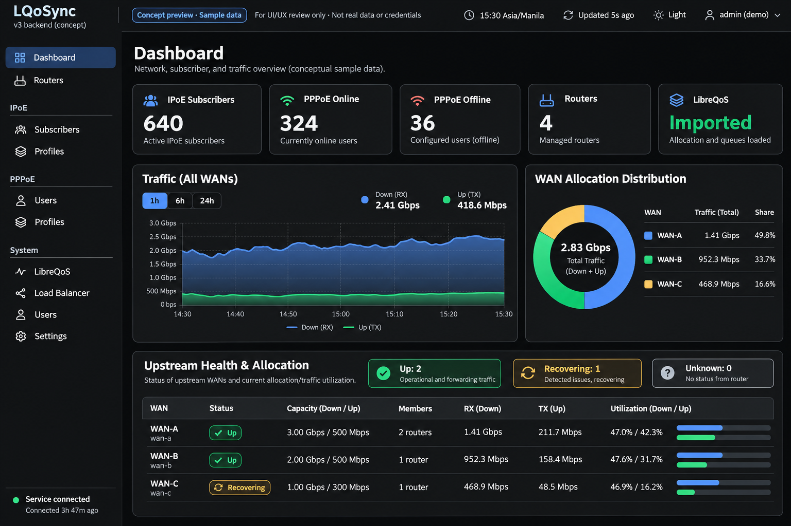

Purpose: Counts, collection freshness, traffic summary, health, WAN capacity, and links to affected records.

Backend and delivery: see [backend map](BACKEND_MAP.md) and tasks F06 in the [implementation plan](IMPLEMENTATION_PLAN.md).

Required correction: Use one overview snapshot. Keep unavailable traffic windows and unproven per-WAN attribution explicit. The generated totals are illustrative.

States to check: loading, empty, stale, partial, unavailable, forbidden, and current data.

## 02. Routers

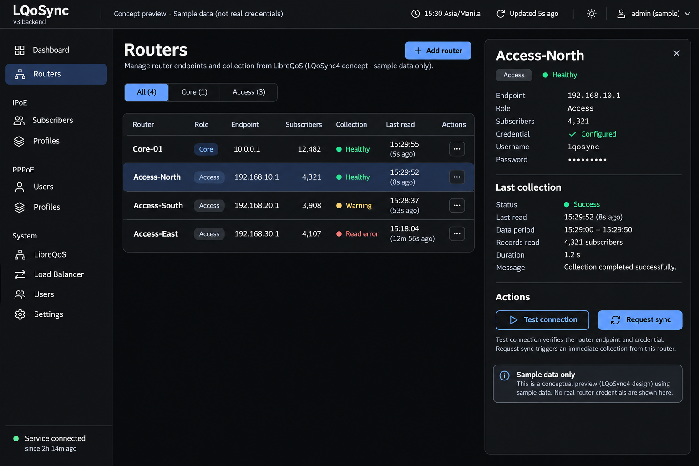

Purpose: Filter router inventory by role and collection state. Open safe details and recent collection errors.

Backend and delivery: see [backend map](BACKEND_MAP.md) and tasks F08, F15, D04 in the [implementation plan](IMPLEMENTATION_PLAN.md).

Required correction: Initial view is read-only. Add/test/sync controls need typed service operations. Keep credential values out of DTOs and drawers.

States to check: loading, empty, stale, partial, unavailable, forbidden, and current data.

## 03. IPoE Subscribers

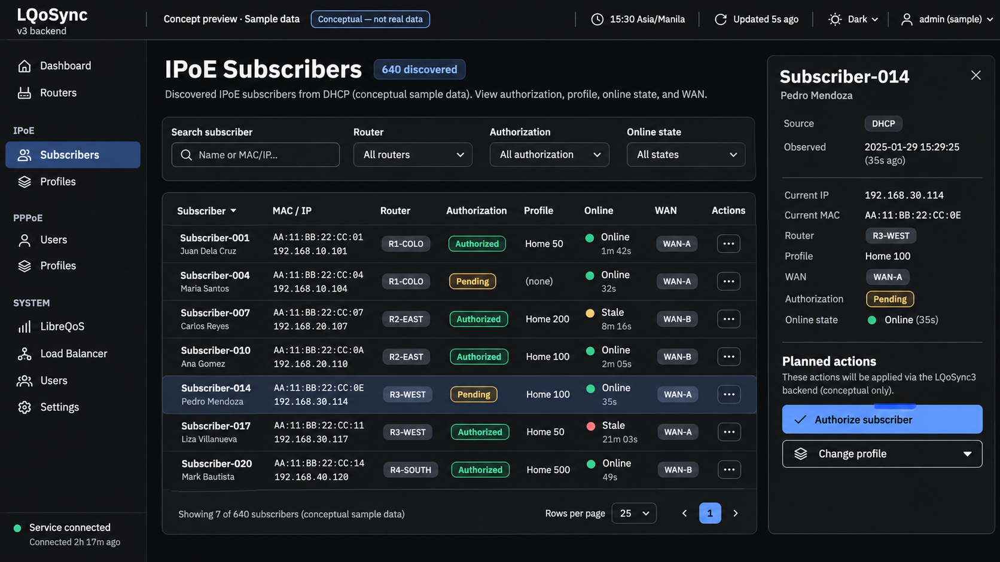

Purpose: Search DHCP observations. Inspect stable identity, current IP/MAC, router, local plan, freshness, and shaping parent.

Backend and delivery: see [backend map](BACKEND_MAP.md) and tasks F07, F11 in the [implementation plan](IMPLEMENTATION_PLAN.md).

Required correction: Authorization does not follow from a DHCP lease. The pictured Authorize button requires D02 and must not ship in the initial release.

States to check: loading, empty, stale, partial, unavailable, forbidden, and current data.

## 04. IPoE Profiles

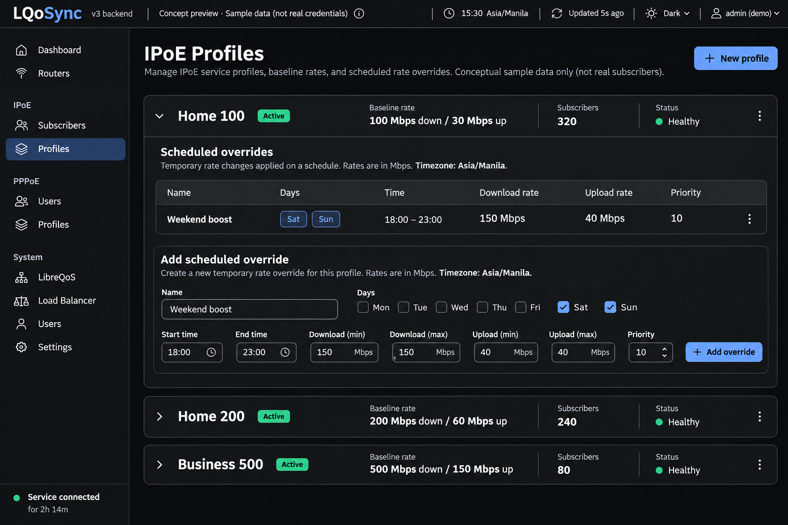

Purpose: Show local plan baseline, membership, effective speed source, and proposed schedule editor.

Backend and delivery: see [backend map](BACKEND_MAP.md) and tasks F11, D01 in the [implementation plan](IMPLEMENTATION_PLAN.md).

Required correction: Use shared local plans. Schedule rows and Add override remain unavailable until D01 defines overlap, timezone, and restart rules.

States to check: loading, empty, stale, partial, unavailable, forbidden, and current data.

## 05. PPPoE Users

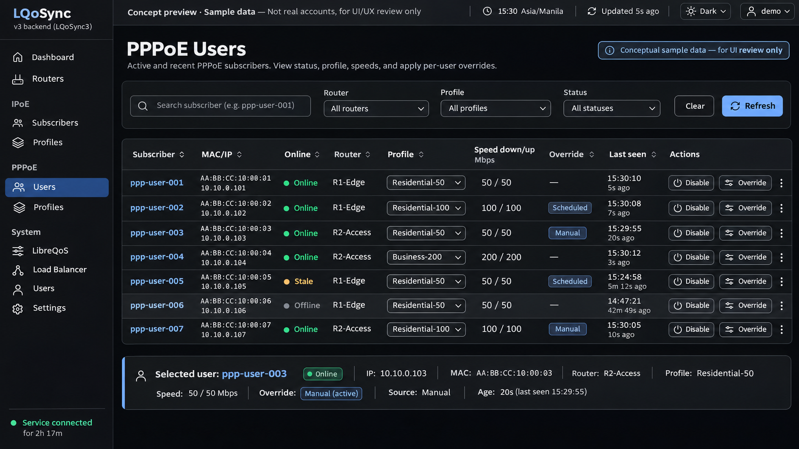

Purpose: Filter PPPoE identities by router, plan, and observed state. Show local plan and resolved speed source.

Backend and delivery: see [backend map](BACKEND_MAP.md) and tasks F07, F11 in the [implementation plan](IMPLEMENTATION_PLAN.md).

Required correction: Do not write RouterOS profiles or disable PPP accounts from these pictured controls. Initial mutations select supported local plans only.

States to check: loading, empty, stale, partial, unavailable, forbidden, and current data.

## 06. PPPoE Profiles

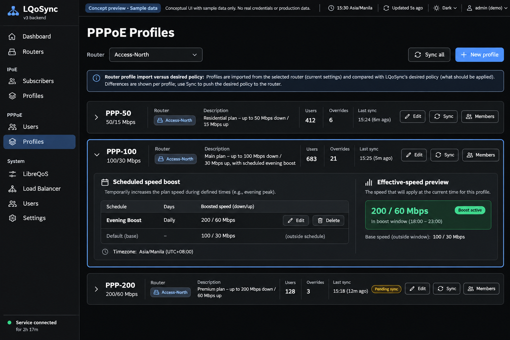

Purpose: Show local plans, subscriber membership, rate policy, and effective-speed details.

Backend and delivery: see [backend map](BACKEND_MAP.md) and tasks F11, D01 in the [implementation plan](IMPLEMENTATION_PLAN.md).

Required correction: The image describes router profile sync. Replace that behavior with local LQoSync plan management. RouterOS remains responsible for sessions and authentication.

States to check: loading, empty, stale, partial, unavailable, forbidden, and current data.

## 07. LibreQoS

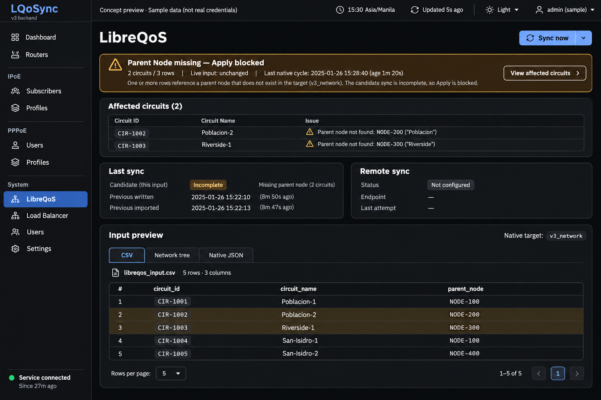

Purpose: Show candidate diagnostics, written receipt, import evidence, waiting identities, affected circuits, and paged input preview.

Backend and delivery: see [backend map](BACKEND_MAP.md) and tasks F09 in the [implementation plan](IMPLEMENTATION_PLAN.md).

Required correction: The pictured CSV is an illustrative projection. Use the actual selected target schema. A previous import does not clear a newer blocked candidate or prove dataplane application.

States to check: loading, empty, stale, partial, unavailable, forbidden, and current data.

## 08. Load Balancer: Allocations

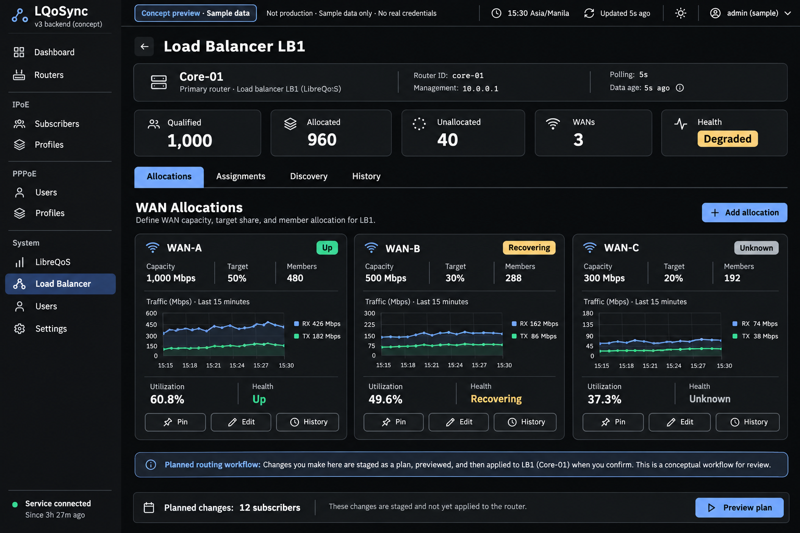

Purpose: Show WAN nodes, configured capacity, membership, and supported policy editing.

Backend and delivery: see [backend map](BACKEND_MAP.md) and tasks F12, D02 in the [implementation plan](IMPLEMENTATION_PLAN.md).

Required correction: Initial label is WAN topology. Do not imply that shaping membership changes routes. Per-WAN traffic needs attribution evidence. Actual routing controls require D02.

States to check: loading, empty, stale, partial, unavailable, forbidden, and current data.

## 09. Load Balancer: Assignments

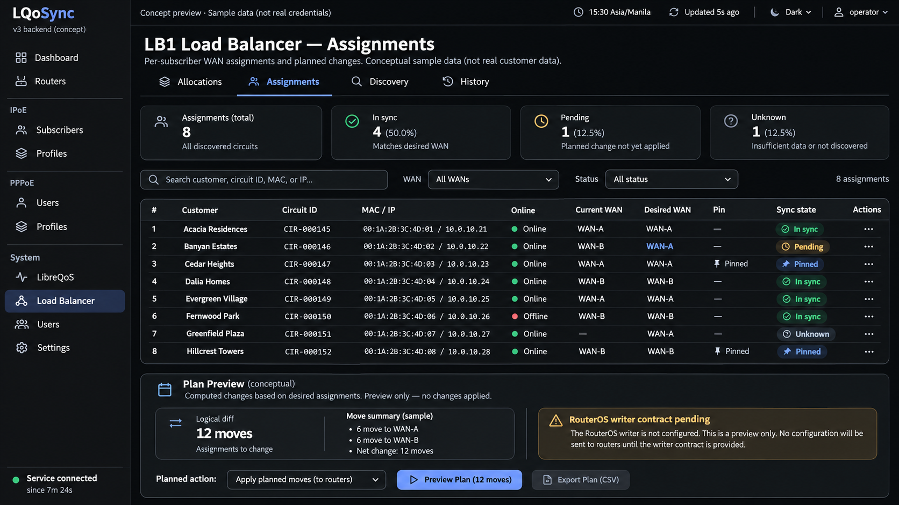

Purpose: Search resolved subscriber placement. Show pin state, reason, desired revision, publication phase, and supported pin/rebalance proposals.

Backend and delivery: see [backend map](BACKEND_MAP.md) and tasks F13, D02 in the [implementation plan](IMPLEMENTATION_PLAN.md).

Required correction: Current/desired routing columns must become shaping-placement columns unless routing observations exist. Keep saved policy and dataplane evidence distinct.

States to check: loading, empty, stale, partial, unavailable, forbidden, and current data.

## 10. Users

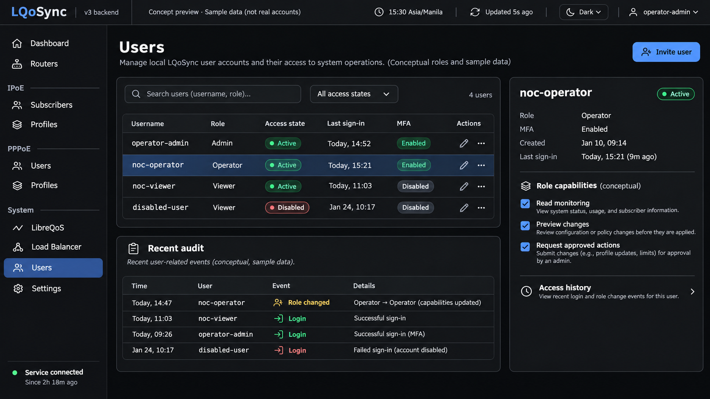

Purpose: List local accounts, roles, access state, session revocation, and safe audit events.

Backend and delivery: see [backend map](BACKEND_MAP.md) and tasks F04, F14 in the [implementation plan](IMPLEMENTATION_PLAN.md).

Required correction: MFA and email invitations are not implemented. Initial administration creates local accounts. Do not display enabled MFA without a verified implementation.

States to check: loading, empty, stale, partial, unavailable, forbidden, and current data.

## 11. Settings

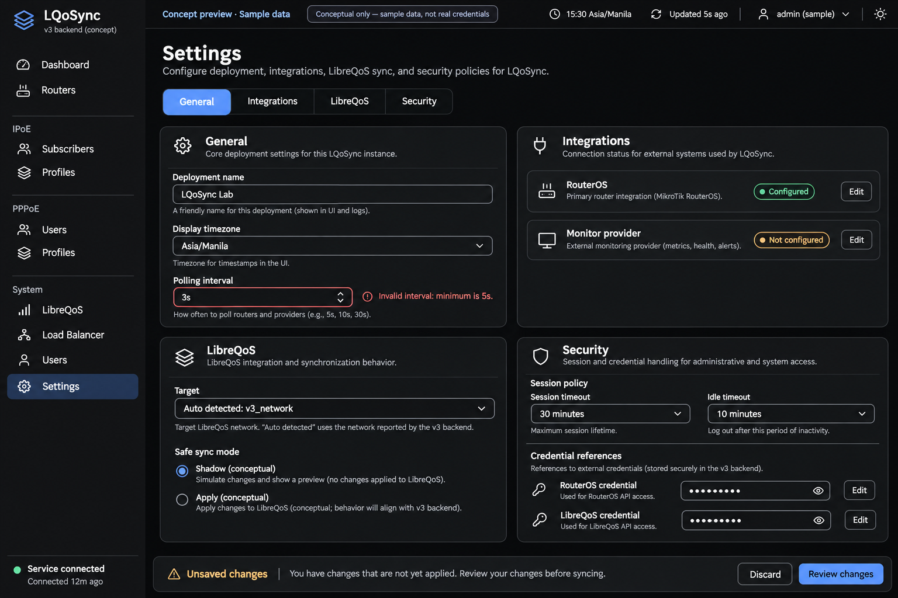

Purpose: Edit allowlisted configuration with current digest, field validation, review, save result, and reload evidence.

Backend and delivery: see [backend map](BACKEND_MAP.md) and tasks F15, F18 in the [implementation plan](IMPLEMENTATION_PLAN.md).

Required correction: The pictured interval limit, security fields, and credential controls are proposals. Current domain validation defines allowed values. Secrets remain write-only.

States to check: loading, empty, stale, partial, unavailable, forbidden, and current data.

## More views without a generated picture

Topology needs a Builder tree, Policies, and a publication strip beyond the pictured WAN cards.
Workers and Journal preserve existing diagnostics through browser-specific read adapters.
Load Balancer Discovery and History are tab labels in the pictures. Their separate bodies were not generated.

Mobile variants, login, bootstrap, conflict dialogs, and action recovery also need browser designs during their implementation tasks.
Do not invent completed mockups or working code for those views.
