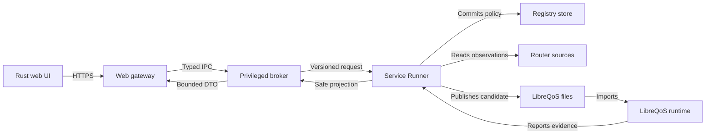
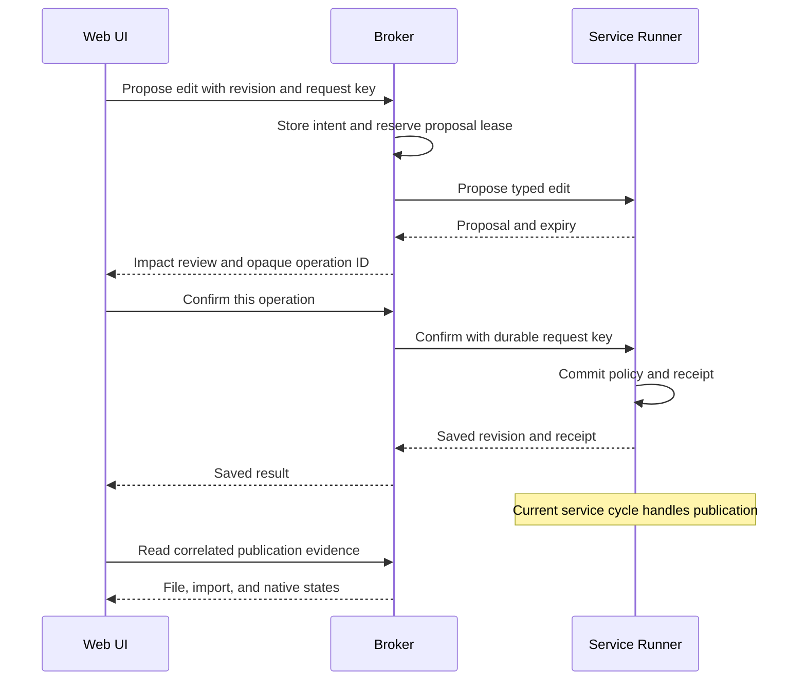

# Topology web connections and integrity

Status: proposed adapter contract. No route in this document exists merely because it appears in a table.
Source checkpoint: `76563ee`, 2026-11-21, Asia/Shanghai.
Read [the design](TOPOLOGY_DESIGN.md) and [the delivery plan](TOPOLOGY_IMPLEMENTATION_PLAN.md).

## Current boundaries

| Source | Verified responsibility | Port rule |
|---|---|---|
| [TUI route](../../src/tui/topology/mod.rs) | Four views, cached state, forms, proposals, and service requests | Reuse behavior and do not import terminal widgets into Wasm |
| [Builder](../../src/tui/topology/builder.rs) | Inventory, instances, hierarchy, and selected details | Separate source identity from node identity |
| [Assignments](../../src/tui/topology/assignments.rs) | Subscriber identity, destination, plans, and pins | Use full identity scope for mutations |
| [Policies](../../src/tui/topology/policies.rs) | Defaults, profiles, local plans, and factors | Preserve units and inheritance |
| [Changes](../../src/tui/topology/changes.rs) | Current revision, rounded exports, and conflicts | Do not claim complete historical audit coverage |
| [Dispatch](../../src/api/dispatch.rs) | Allowed service operations and typed arguments | Add a narrow web adapter and no arbitrary operation proxy |
| [Runner](../../src/runner.rs) | Serial service owner, previews, proposals, commits | Keep all domain evaluation here |
| [Protocol](../../src/api/protocol.rs) | Version 1, JSON lines, 1 MiB requests, 16 MiB responses | Preserve bounds and verify complete response envelopes |
| [Service client](../../src/api/client.rs) | Unix-socket request with a 120-second default timeout | Add version/ID/result validation before generic web reuse |
| [Web broker](../../crates/web-gateway/src/broker.rs) | Fixed private IPC, gateway UID, accounts, safe cached views | Extend its typed enum and authorization and keep root-only data private |
| [HTTP router](../../crates/web-gateway/src/http.rs) | Authenticated routes, sessions, CSRF, and Origin checks | Apply the same checks to every topology mutation |
| [Catalog](../../src/topology_manager/catalog.rs) and [layout](../../src/topology_manager/layout.rs) | Node types, source targets, capacity policies, and hierarchy validation | Do not duplicate these rules as browser authority |
| [Identity model](../../src/topology_manager/model.rs) and [IDs](../../src/topology_manager/ids.rs) | Stable records and independent current endpoints | Never address a mutation only by IP or display name |
| [Edits](../../src/topology_manager/edits.rs) and [plans](../../src/topology_manager/plans.rs) | Narrow edits, ranges, plan identity, and validation | Map each UI action to one supported operation |
| [Preview](../../src/topology_manager/preview.rs) | Evaluated nodes, active subscribers, identities, and source inventory | Project typed bounded DTOs and distinguish cached age and revision |
| [Store](../../src/topology_manager/store.rs) and [staging](../../src/topology_manager/staging.rs) | Revision checks, ownership, backups, and recovery | No direct web writes to these files |
| [Publication](../../src/topology_manager/publication.rs), [receipt](../../src/write_receipt.rs), [native evidence](../../src/apply_evidence/take_effect.rs) | File transactions, import evidence, per-identity acceptance | Correlate evidence and never infer acceptance from one generation number |
| [Runtime owner](../../src/topology_manager/runtime.rs) and [CLI](../../src/topology_cli.rs) | Activation and controlled migration boundaries | Read capability and do not expose activation through generic HTTP execution |

The current gateway has router, overview, and traffic surfaces. It has no topology route family at this checkpoint.
The graph contains older topology notes. The current source, not an old milestone, establishes the capability map above.

## Data path

The service owns collection and publication. The web path supplies intent and displays evidence.
The gateway and browser have no direct RouterOS or registry-file access.

## Current service operations

These exact operation names come from `src/api/dispatch.rs`.
The classification concerns effects, not HTTP method names.

| Operation | Effect | Web mapping |
|---|---|---|
| `status` | Reads mode, revision, enrollment, writer, and cycle start | Workspace capability and status projection |
| `registry.get` | Returns a private full registry | Broker/core projection input only and never a browser response |
| `topology.tree` | Reads the catalog and pin presence from cached evidence | Tree/source/pin projection |
| `topology.preview.get` | Returns cached preview or null and no router read | Observation projection |
| `topology.policies` | Reads defaults, profiles, plans, and groups | Policies projection |
| `topology.preview.refresh` | Reads routers and prepares/caches a candidate | Explicit Refresh job |
| `wan.discover` | Reads interfaces on configured routers | Explicit Discover WAN job |
| `topology.sources.candidates` | Creates candidates from a fresh source draft | Explicit Discover sources job |
| `topology.edit.propose` | Reads/evaluates a candidate and keeps one proposal | Typed edit proposal job |
| `topology.edit.confirm` | Commits the kept candidate under its base revision | Session-bound confirmation job |
| `topology.edit.cancel` | Drops the matching kept proposal | Session-bound cancellation |
| `plan.create`, `plan.update`, `plan.delete` | Commit local-plan changes with `expected_revision` | Typed plan jobs and service has no separate proposal step here |
| `subscriber.plan` | Commits a plan choice for a complete source identity | Typed subscriber plan job |
| `policy.commit` | Replaces catalog/source settings under revision checks | Private only and not a browser escape hatch |

Plan and subscriber-plan methods currently commit without the Builder's separate impact proposal.
The web mutation adapter must add service-side aggregate preflight or a service-generated review before those edits ship.
Reuse the core evaluator. A browser estimate cannot establish safe aggregate capacity.

All GET routes below read current state only.
Do not copy the TUI's refresh-on-open behavior into browser GET or route entry.
A refresh/discovery job can contact enabled routers. Its button and review text must say so.
All paths must keep the disabled-router I/O barrier.

## New HTTP contract

This section proposes every route below. Use typed broker enum variants for the same operations.
The first release can expose reads before writes pass their gates.

| Proposed route | Purpose | Service dependency |
|---|---|---|
| `GET /api/v1/topology` | Workspace capability and coherent evidence envelope | New bounded snapshot projection |
| `GET /api/v1/topology/tree` | Tree window and source inventory | Same snapshot and parent/cursor filters |
| `GET /api/v1/topology/nodes/{id}` | Selected node, ancestry, capacity, source | Same snapshot and stable node ID |
| `GET /api/v1/topology/assignments` | Filtered/sorted subscriber page | Same snapshot and stable cursor |
| `GET /api/v1/topology/subscribers/{id}` | All identities, current endpoints, plan, pin | Same snapshot and stable subscriber ID |
| `GET /api/v1/topology/policies` | Defaults, local plans, source factors, fallback | Same registry revision |
| `GET /api/v1/topology/changes` | Bounded conflicts, rounded exports, receipts, web history | New safe history/evidence projection |
| `POST /api/v1/topology/refresh` | Start observation refresh | `topology.preview.refresh` through job runner |
| `POST /api/v1/topology/discovery` | Discover `wan` or `sources` | Fixed enum and never a browser-supplied operation string |
| `POST /api/v1/topology/proposals` | Propose one allowed `Edit` | `topology.edit.propose` |
| `POST /api/v1/topology/proposals/{id}/confirm` | Confirm reviewed intent | Private mapping to service proposal ID |
| `POST /api/v1/topology/proposals/{id}/cancel` | Cancel this session's proposal | Private mapping to service proposal ID |
| `POST /api/v1/topology/plans` | Create one local plan | `plan.create` |
| `PATCH /api/v1/topology/plans/{id}` | Update supported plan fields | `plan.update` |
| `DELETE /api/v1/topology/plans/{id}` | Delete an unused local plan after review | `plan.delete` and refuse referenced plans |
| `PUT /api/v1/topology/subscribers/{id}/plan` | Select or clear a local plan | `subscriber.plan` and resolve complete identity explicitly |
| `GET /api/v1/topology/operations/{id}` | Read this principal's operation result | Durable web operation store and authoritative receipt |

A browser proposal ID is opaque. Do not expose the core's predictable `edit-<revision>-<sequence>` token.
A subscriber with several identities needs an explicit selected scope. The server must not choose the first identity silently.
Use the stable subscriber ID plus the selected identity reference to check that the record still matches.

## Coherent read envelope and limits

Add a narrow core projection, provisionally `topology.web.snapshot`, instead of separate replies without a revision fence.
This is a new service operation, not a current capability.
The Runner returns one consistent registry view and separately tagged observation/publication evidence.

The cached preview lists active observations. It is not a complete offline subscriber catalog.
The new projection must supply offline pin records separately from current endpoints.
Count active subscribers and known offline records separately.
A cached preview can belong to an older revision. Preserve that revision and mark it stale.

Never relabel old observations with the current registry revision.

The proposed envelope contains these fields:

| Field | Contract |
|---|---|
| `schema_version` | Explicit DTO version. Reject unknown versions. |
| `snapshot_id` | Opaque read-view identity and binds pages and filters |
| `registry_revision` | Decimal string and broker converts to checked `u64` for the core |
| `observed_revision`, `observed_at`, `generation` | Nullable observation evidence and no guessed current generation |
| `writer`, `runtime_mode`, `enrolled`, `capabilities` | Service-derived availability and allowed actions |
| `publication` | Nullable write ID, file outcome, phase, timestamps, and explicit revision correlation |
| `native` | Per-identity counts/reasons with bounded details and receipt identity |
| `stale`, `partial`, `truncated` | Independent flags with safe reasons |
| `next_cursor`, `total` | Stable page continuation and exact total when available |

Proposed limits: 200 rows per page, 500 displayed tree rows, 64 KiB request bodies, and 512 KiB HTTP responses.
These are adapter limits to validate, not current service guarantees.
Include selected ancestry in a tree window and account for it in the row limit.
Filter and sort before page selection. Bind cursors to snapshot, sort, and filter values.
Return a snapshot-expired conflict when pages belong to different revisions.

Do not truncate JSON bytes or hide conflicts to satisfy a limit.
Return bounded summaries with counts and explicit continuation, or an unavailable response.
The current 16 MiB service limit still matters. Page selection after receipt does not fix an oversized core response.
The new core projection must apply bounds before serialization and serve pages from one stable read view.

Keep arithmetic in core integer/rational types. Send revisions, large counters, and exact factor values as strings where needed.
Convert Mbps only through checked core rules. Reject NaN, infinity, overflow, and unsupported precision.
Do not calculate publication acceptance, budgets, or placement decisions from browser floats.

## Mutation ownership and unknown outcomes

The service keeps one in-memory proposal for 120 seconds.
A new `api_edit_propose` clears the previous proposal before evaluation.
Confirm checks the stored ID, expiry, and base revision. A service restart loses the proposal.
The current service has no durable request-key result query.
These facts require explicit web rules before mutations can ship.

1. Authenticate and authorize the request. Derive the actor from the server session.

2. Validate the narrow request, base revision, selected identity, and browser idempotency key.

3. Persist intent before dispatch. Bind its opaque operation ID to principal, payload hash, base revision, and session version.

4. Use one broker mutation lane. Hold its proposal lease until confirm, cancel, invalidation, or the core expiry.

5. Return `202 Accepted` and an operation URL. A browser timeout must not cancel or repeat the core write.

6. Return the current operation for the same key and payload. Reject the same key with a different payload.

7. Store the service proposal token privately. Confirm/cancel only through this principal's operation record.

8. On replacement, expiry, restart, or revision conflict, invalidate the review and keep the browser draft.

9. After confirmation, show Saved only after a definite commit acknowledgement or an authoritative receipt.

10. On transport loss after dispatch, record Outcome unknown. Never replay the mutation automatically.

A broker-only queue cannot prevent a local TUI or CLI edit that replaces its proposal.
Treat that replacement as a conflict. Never confirm a replacement with another operation's token.
An unchanged revision alone does not prove that a timed-out mutation failed.

Before writes ship, add a core request-key/receipt contract for supported web mutations.
The request key, committed policy revision, payload hash, and result must survive a crash together or through an equivalent recoverable store protocol.
The service must return the same receipt for a repeated key and reject a changed payload.
Keep a receipt lookup operation so the broker can resolve a lost reply after restart.
Do not implement a separate web transaction that claims atomicity with the core registry.

A web operation can be `queued`, `running`, `review_ready`, `saved`, `failed`, `expired`, `cancelled`, or `outcome_unknown`.
The adapter will use these proposed states. They are separate from core publication phases.

Session revocation blocks new confirmation. A dispatched operation remains auditable and does not become a second write.
A queued undispatched action can cancel. Do not promise cancellation after a commit starts.

## Edit and publication sequence

The durable confirmation contract in this sequence is new work.
It must pass crash/retry tests before the web can enable the Confirm action.

## Publication and failure states

The core phase enum contains `INTENT`, `PENDING`, `IMPORT_CONFIRMED`, `APPLIED`, `WRITE_FAILED`, `APPLY_FAILED`, `VERIFY_TIMEOUT`, `SUPERSEDED`, `INTERRUPTED`, and `CANDIDATE`.
File outcomes also distinguish Pending, Written, Unchanged, Reconciled, and Failed.
Project these states with safe labels. Do not invent a receipt when the current API omits it.

A publication projection needs an explicit link from policy revision to write ID and native evidence.
If that link does not exist, add it to the core receipt contract before the UI shows Applied for a revision.
A newer revision supersedes an older pending result. The UI must not attach an old success to a new save.
A late acceptance can resolve `VERIFY_TIMEOUT` when the core supplies fresh proof.

Keep the last good tree while refresh runs. A conflict preview can contain empty nodes/subscribers by design.
Do not interpret those empty arrays as confirmed deletion of the whole network.
Show the failed preview beside its last successful observation with separate timestamps and revisions.
Unknown writer state disables writes and points to recovery evidence. It never selects the legacy writer silently.

## Security and release proof

Require session, account version, authorization, CSRF, and same-origin checks for every mutation.

Keep the gateway behind the configured HTTPS proxy. Preserve the broker's UID checks and fixed operation allowlist.
The broker checks request version, response version, response ID match, and the complete success/error shape.
The current `src/api/client.rs` and router test exchange do not validate all those envelope fields.
Do not reuse those gaps for the new topology path. A focused transport validation change can improve shared reuse later.

Never return raw registry documents, credentials, filesystem paths, or unbounded service errors.
Record safe error codes and subject IDs. Keep subscriber PII out of routine request logs.
Do not add command names, shell arguments, arbitrary paths, or arbitrary `op` fields to browser DTOs.

Read-only delivery needs coherent reads, safe projection, page limits, and authorization.
Mutation delivery additionally needs durable receipts, proposal ownership, idempotency, crash recovery, and revision-bound review.
The [implementation plan](TOPOLOGY_IMPLEMENTATION_PLAN.md) makes these separate release gates.
