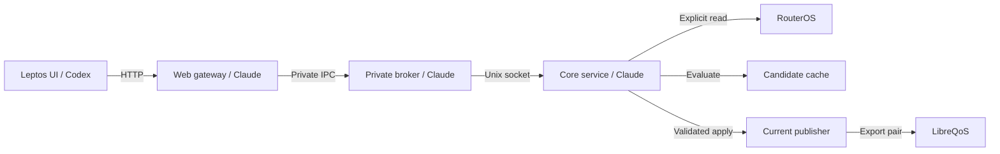

# Topology Studio: frontend and backend contract

Status: contract version 1 types exist since task B0 in `crates/web-contract/src/source_studio.rs`.
Since task B1, the production service has `GET /api/v1/topology/source-capabilities` and the `draft_test` job of `POST /api/v1/topology/source-jobs`.
It advertises `draft_test` only. The other routes and jobs return `404` until their tasks pass. The browser fixture serves all new HTTP shapes.
The [product design](ROUTER_SOURCE_CONFIGURATION.md) defines the required behavior.
The [tandem plan](../superpowers/plans/2026-11-23-topology-studio-tandem.md) assigns the work.

## Ownership and authority

Claude Code owns `crates/web-contract`, the HTTP gateway, private broker, core service, and browser fixture.
Codex owns `crates/web-ui` and browser checks under `tools/frontend`.
The backend publishes the shared Rust types and fixture before the frontend uses a new API.

Neither worker maintains a second copy of a wire type.

The browser uses same-origin HTTP only. The private broker calls the core service through the current Unix socket protocol.
Only the core service reads RouterOS, evaluates policies, changes durable state, and invokes the current publisher.
A GET request starts no router read, policy change, or publication.



The UI receives service results through the same gateway path. Preview uses the candidate cache, without publication.

## Existing interfaces to keep

| HTTP interface | Current request/result | Use |
| --- | --- | --- |
| `GET /api/v1/topology` | `TopologySummary` | Saved topology, collection state, flows, publication evidence |
| `GET /api/v1/routers` | `RouterInventory` | Router list and loaded config digest |
| `GET /api/v1/routers/{id}` | `RouterSummary` | One router and its current settings |
| `POST /api/v1/routers` | `RouterEditForm` → current edit result | Save a new router disabled |
| `PATCH /api/v1/routers/{id}` | `RouterEditForm` → current edit result | Connection, credentials, and existing source settings |
| `POST /api/v1/routers/{id}/test` | Existing test request → `RouterTestResult` | Test a registered enabled router |
| `POST /api/v1/topology/reads` | `ReadRequest` → `202 Operation` | Explicit current-source refresh or discovery |
| `POST /api/v1/topology/edits` | `EditRequest` → `202 Operation` | One validated automatic policy edit |
| `PUT /api/v1/topology/layout` | `LayoutRequest` → `LayoutReply` | Layout revision only |
| `GET /api/v1/topology/operations/{key}` | `Operation` | Actor-scoped job or edit status |
| Existing assignments and observations GETs | Current page types | Saved subscriber details |

Keep the existing response shapes. Do not wrap old responses in a new envelope.
The current router edit digest and topology registry revision protect different stores.
Do not substitute one for the other.

## New interfaces

Create `crates/web-contract/src/source_studio.rs`. Export it from `lib.rs`.
Use the exact names below in the contract, fixture, gateway, and frontend.

| Proposed HTTP interface | Method | Result |
| --- | --- | --- |
| `/api/v1/topology/source-capabilities` | GET | `StudioCapabilities` |
| `/api/v1/routers/{id}/source-config` | GET | `RouterSourceConfig` |
| `/api/v1/topology/source-jobs` | POST `StudioJobRequest` | `202 Operation` plus current `Location` header |
| `/api/v1/topology/source-candidates/{id}` | GET | `CandidateSummary` |
| `/api/v1/topology/source-candidates/{id}/records` | GET with `CandidatePageQuery` | `CandidatePage<ResolvedRecord>` |
| `/api/v1/topology/source-candidates/{id}/issues` | GET with `CandidatePageQuery` | `CandidatePage<ValidationIssue>` |

New cached GETs require the current session. Candidate GETs also require the candidate's actor.
New POSTs require the current same-origin and CSRF checks.
Return `Cache-Control: no-store`, as the gateway does today.

### Capability and config types

| Type | Required fields |
| --- | --- |
| `StudioCapabilities` | `version: u32 = 1`, `features: Vec<StudioFeature>`, `fields: Vec<FieldSpec>`, `limits: StudioLimits` |
| `StudioFeature` | Closed enum: `draft_test`, `access_profiles`, `source_collect`, `policy_preview`, `policy_save`, `wan_evidence` |
| `FieldSpec` | `field: FieldKey`, `source: SourceKind`, `operators: Vec<FilterOp>`, `groupable: bool` |
| `RouterSourceConfig` | `version`, `router_id`, `config_digest`, `loaded_config_digest`, `policy_revision`, `enabled`, `access_profiles`, `policies`, `snapshots`, `wan_candidates: Vec<WanEvidence>` |
| `AccessProfileView` | `id`, `label`, `credential_set: bool`, `supported_writes: Vec<WriteScope>` |
| `SnapshotRef` | `id`, `router_id`, `config_digest`, `collected_from`, `collected_to`, `expires_at`, `tables: Vec<TableEvidence>` |
| `TableEvidence` | `table: TableId`, `state: ReadState`, `records: u64`, `collected_at`, `issue_code: Option<String>` |

`TableId` uses the current reader tables: interfaces, routes, PPP secrets/profiles/active, DHCP servers/leases, and Hotspot users/servers/profiles/active.
Use snake_case table names on the wire. Missing mandatory tables prevent evaluation.
All digests and IDs are opaque strings. All times use Unix seconds as `u64`.

Use decimal strings for new policy revisions and exact bit rates.
`RouterSourceConfig.policy_revision` is `Option<String>`. It is `None` before the current registry exists.
Keep connection editing and explicit collection available under their current gates.

Require current topology initialization before a policy commit or evaluation. Do not initialize or activate it from a GET.
Parse the existing `EditRequest.expected_revision` into Rust `u64`. Do not pass it through a JavaScript number.
`ReadState` is `complete`, `partial`, `failed`, `not_requested`, or `stale`.

A partial or failed table never becomes an empty complete table.

An absent capability endpoint, version mismatch, or missing feature keeps the related control unavailable with a clear reason.
Keep the current working canvas available. A new button must not simulate success against an old backend.

### Policy types

`RouterSourceConfig.policies` is the ordered set of saved `SourcePolicyDraft` records for that router.
Use a backend-assigned ID after save. An unsaved record has `id: None`.

| `SourcePolicyDraft` field | Type and rule |
| --- | --- |
| `id` | `Option<String>` |
| `name` | `String`, 1–128 UTF-8 bytes |
| `enabled` | `bool` |
| `priority` | `u16`, lower value wins |
| `source` | `SourceKind`: `ppp`, `dhcp`, `hotspot`, `wan` |
| `read_access_ref` | `String`, valid profile of this router |
| `members` | `MemberMode`: `active`, `configured`, `joined` |
| `filter` | `FilterExpr` |
| `group` | `GroupRule` |
| `identity` | `IdentityMode::Registry` only in version 1 |
| `rates` | Ordered `Vec<RateSource>` |
| `parent` | `ParentRule` |
| `capacity` | `CapacityRule` |
| `writes` | `Vec<WriteGrant>`, empty by default |

The backend chooses allowlisted read tables and joins from this typed policy.
Do not accept command paths, scripts, executable templates, or arbitrary joins from the browser.
Configured-only records still need verified export endpoints and current identity admission.

Missing active endpoints do not authorize invented addresses or identity records.

| Supporting type | Version 1 values |
| --- | --- |
| `FieldKey` | `active.service`, `active.comment`, `account.profile`, `account.comment`, `lease.status`, `lease.server`, `server.name`, `user.profile`, `hotspot.server`, `interface.name`, `route.routing_table` |
| `FilterOp` | `eq`, `ne`, `prefix`, `contains`, `in` |
| `FilterExpr` | Tagged enum: `all { rules }`, `any { rules }`, `match { field, op, value }` |
| `FilterValue` | Tagged enum: `text { value: String }`, `texts { values: Vec<String> }` |
| `GroupRule` | Tagged enum: `by_field { field }`, `fixed { name }`, `attach { node_id }` |
| `ParentRule` | Tagged enum: `router`, `node { node_id }` |
| `RateSource` | Tagged enum: `subscriber_override`, `account_comment`, `active_comment`, `profile_map`, `server_map`, `profile_rate_limit`, `fallback` |
| `PlanBinding` | `{ selector: String, plan_id: String }`, exact selector match |
| `CommentRateFormat` | `legacy_configured` only until another parser has tests |
| `CapacityRule` | Tagged enum: `from_plans { down_factor, up_factor, minimum_down_bps, minimum_up_bps }` or `fixed { down_bps, up_bps }` |
| `WriteScope` | `wan_address_lists` only when the current writer supports it |
| `WriteGrant` | `{ access_ref, scope: WriteScope, enabled: bool }` |

Use `kind` as the serde tag for these supporting enums.
`account_comment` and `active_comment` carry `format: CommentRateFormat`.
`profile_map` and `server_map` carry `bindings: Vec<PlanBinding>`.

`profile_rate_limit` uses the existing directional/unit parser. `fallback` carries `plan_id`.
Factor values use exact decimal strings. Rate values use positive decimal bps strings. Zero is valid for a minimum rate.
The backend validates source-specific field and rate compatibility.

Only advertise fields that the current reader can supply. The enum alone does not establish support.

Equal-priority overlapping ownership is a blocker. Stable policy ID breaks display-order ties only.
The rate list supplies explicit precedence. Report competing rates without silently changing the saved precedence.
Reuse the current identity, grace, ancestor capacity, and shared-budget rules.

A source WAN pin and subscriber WAN assignment remain separate typed operations.
Use current `wan.create` for a saved WAN node. Persist ignore/pin decisions in backend WAN policy state.

### WAN decisions and existing node edits

`WanEvidence` contains `interface`, `routes: Vec<RouteEvidence>`, `interface_state`, `read_state`, `last_observed_at`, and `decision`.
`RouteEvidence` contains `routing_table`, `active`, `gateway`, `resolved_interface`, and `observed_at`.
Unknown gateways, resolved interfaces, and observation times use `Option` fields.

Add `BuilderEdit::WanCandidateSet { router_id, expected_config_digest, interface, decision }` with wire kind `wan.candidate_set`.
`WanCandidateDecision` is `pin`, `ignore`, or `clear`. The envelope still supplies the expected registry revision and request key.
Store decisions as `CatalogRouter.wan_decisions: Vec<StoredWanDecision>`, with an empty default during migration.

A pin classifies the source. Current `wan.create` still creates the configured WAN node after capacity validation.
No candidate decision changes RouterOS routes or enables the WAN-list writer.
Require both `wan_evidence` and `policy_save` before the frontend exposes decision actions.

Keep current `node.tree_exclude`, source exclusion, node capacity, factor, allocation, and layout edits.
These controls call the current typed variants. They do not need another policy engine in the browser.

### Access profiles and save order

Extend `RouterEdit` with `access_profiles: Option<Vec<AccessProfileEdit>>` under the existing config digest check.
`AccessProfileEdit` contains `id`, `label`, `username`, `password: Option<SecretInput>`, and `supported_writes`.
Allow at most 8 profiles per router. Reuse current username, password, and CA limits for both edits and draft tests.

An absent password keeps the saved secret. Responses never return the password.
Resolve the existing router credential as an implicit `default` access profile for old configs.
An explicit profile can serve both reads and supported writes. Full account permission does not enable an operation automatically.

Credential replacement keeps the existing operator reauthentication rule.

Save access profiles through the router edit path first.
Wait until `loaded_config_digest == config_digest` before a policy save that uses the new profiles.
Then send the complete router policy set through the existing edit endpoint:

```json
{
  "key": "studio-save-0000000001",
  "expected_revision": 18,
  "edit": {
    "kind": "router.sources_set",
    "router_id": "lq3-a1",
    "expected_config_digest": "opaque-config-digest",
    "policies": []
  }
}
```

Store the new policy set in `CatalogRouter.source_policies: Option<Vec<StoredSourcePolicy>>`.
`None` keeps current source behavior. `Some([])` explicitly selects no policy sources.
When the field is present, it controls source selection. The registered router enabled flag remains the connection gate.

Do not run the old source selectors and new policy selectors as competing authorities.

`BuilderEdit::RouterSourcesSet` owns this new variant. An empty policy set means an explicit removal of all source policies for that router.
Validate its destructive effect through current service rules. Never interpret missing JSON as an empty set.
The core serializes validation and commit against config reload and policy edits.

A stale config digest or registry revision refuses the edit before commit.
This sequence does not claim an atomic transaction across the config file and registry.
If policy save fails, keep the draft and show that the access profile saved separately.

The credential field never travels inside `BuilderEdit` or a topology receipt.

### Source jobs

`StudioJobRequest` contains `{ key: String, job: StudioJob }`.
Use `kind` as the job tag. Reuse the current actor-scoped operation queue.

| `StudioJob` variant | Required fields | Result |
| --- | --- | --- |
| `draft_test` | `connection: DraftConnection`, `required_sources: Vec<SourceKind>` | `DraftTestReport` |
| `collect` | `router_id`, `expected_config_digest`, `sources: Vec<SourceKind>` | `SnapshotRef` |
| `evaluate` | `router_id`, `expected_revision: String`, `expected_config_digest`, `snapshot_id`, `policies: Vec<SourcePolicyDraft>` | `CandidateRef` |

`DraftConnection` contains `address`, `port`, `tls`, `tls_verify`, `username`, `password`, and optional `ca_pem`.
Keep draft secrets in memory only. Redact `Debug`, errors, audit records, and job metadata.
A draft test is an explicit one-shot read. It saves no router and enables no periodic read.

The existing test of a registered disabled router remains disabled.
A collection job contacts only enabled registered routers. An evaluation job never contacts RouterOS.
A policy evaluation applies the draft as a replacement in a cloned current policy, then validates the complete topology.

Keep unrelated routers and sources in that clone. Detect conflicts against their existing ownership.

Extend `Operation` with `#[serde(default)] source_result: Option<StudioJobResult>`.
Use `StudioJobResult` variants `draft_test`, `snapshot`, and `candidate`, each with its typed result.
Keep `queued`, `running`, `done`, and `failed` for read jobs.

Keep the existing mutation states and `WebReceipt` for policy saves.
A source job receipt contains only metadata or a candidate reference, never raw records or secrets.
Unknown or interrupted read-job results require an explicit retry. They cannot imply policy success.

`DraftTestReport` contains `connection_fingerprint`, `at`, `elapsed_ms`, and `checks: Vec<TestCheck>`.
`TestCheck` contains `stage`, `state`, and a safe `code`. Stages cover transport, TLS, authentication, identity, and table permission.
Do not return raw authentication errors. A changed connection draft invalidates the displayed result.

### Candidate results and pagination

| Type | Required fields |
| --- | --- |
| `CandidateRef` | `id`, `base_revision`, `config_digest`, `snapshot_id`, `draft_digest`, `expires_at` |
| `CandidateSummary` | `reference: CandidateRef`, `graph: CandidateGraph`, `diff: CandidateDiff`, `issues: IssueCounts`, `publishable: bool`, `complete: bool` |
| `CandidateGraph` | `nodes: Vec<Node>`, `flows: Vec<Flow>`, `nodes_truncated: bool`, `flows_truncated: bool` |
| `CandidateDiff` | Counts `added`, `removed`, `changed`, `unchanged`, plus bounded markers `{ entity_ref, change }` and `markers_truncated` |
| `IssueCounts` | `blockers`, `warnings`, `information`, all `u64` |
| `CandidatePageQuery` | `cursor: Option<String>`, `limit: u16` |
| `CandidatePage<T>` | `candidate_id`, `items: Vec<T>`, `next_cursor: Option<String>`, `total: u64` |
| `ResolvedRecord` | `record_ref`, `policy_id`, `identity_ref: Option<Identity>`, `group_ref`, `parent_ref`, `down_bps`, `up_bps`, `speed_source`, `provenance`, `issue_codes` |
| `ValidationIssue` | `code`, `severity`, `entity_ref`, `field: Option<FieldKey>`, `message`, `remedy` |
| `Provenance` | `router_id`, `table: TableId`, `snapshot_id`, `record_ref`, `fields: Vec<FieldKey>` |

Unresolved rates and identity references in `ResolvedRecord` use `Option` fields, not invented zero values.
Candidate nodes use the current browser `Node` type. New nodes use `draft:` references until commit.
A candidate cache never allocates a durable Circuit ID or Device ID.

Bind cursors to actor, candidate ID, draft digest, and filter. An expired cursor cannot load a different candidate page.
Calculate all validation counts before any page cut. Truncation of a graph must remain explicit.
If mandatory evaluation is incomplete, `publishable` is false.

A publishable candidate is still a display result. The save path validates current inputs again.

## Limits and errors

Reuse the broker's 64 KiB request line and the 60 KiB topology reply budget.
Do not increase global IPC limits for this feature.
The current default HTTP body limit is 4 KiB. Add a 32 KiB route-local limit for source jobs and topology edits.

Keep the existing default for unrelated routes. Check the complete encoded broker request against its line limit.

| Input or result | Version 1 limit |
| --- | --- |
| Source job HTTP body | 32 KiB |
| Saved policies | 32 per router, serialized policy set at most 24 KiB |
| Filter leaves and depth | 32 leaves per policy, depth 3 |
| Plan bindings | 128 per policy, within total request size |
| Candidate page | Default 50, maximum 100, within reply budget |
| Collection | 20,000 rows per table, 16 MiB per router snapshot, 60-second job deadline |
| Candidate cache | 10 minutes, maximum 4 candidates and 64 MiB per actor, 128 MiB across actors |
| Open jobs | Reuse `MAX_OPEN = 16`; no separate unbounded source queue |

An input limit rejects the request. A collection limit marks evidence partial and prevents absence-based removal.
A page can end early to meet the byte budget. Its cursor must continue from the last returned record.
A process restart expires transient candidates. A later GET returns `410` without repeating discovery.

| HTTP status | Frontend action |
| --- | --- |
| `400` or `413` | Show the safe validation or size reason. Keep the draft. |
| `401` | Clear session and secret inputs. Keep only non-secret draft values in memory. |
| `403` | Show permission or CSRF refusal. Do not retry automatically. |
| `404` | Show unavailable feature or missing router. Preserve the current canvas. |
| `409` | Reload current revisions. Keep the draft for deliberate resubmission. Show `not_initialized` with the current initialization action when required. |
| `410` | Expire the preview. Offer an explicit reevaluation. |
| `429` | Show busy state. Keep the request key. |
| `503` or lost response | Query the existing operation before any resubmission. |

Old endpoints keep current status-only errors.
New endpoints return `StudioError { code, message, field }` with the HTTP status.
A hidden candidate owned by another actor returns `404`. An owned expired candidate returns `410`.

Reuse the same actor/key/payload for retries. Changed payloads need a new key.
`GET /api/v1/topology/operations/{key}` remains the status authority for accepted jobs.

## Frontend state and release rules

Keep saved topology, unsaved draft, candidate, and publication evidence as separate state.
Bind draft state to the authenticated actor in the current tab. Clear it on explicit logout or a different actor.
A same-actor reauthentication can recover non-secret draft values from app memory.

Increment a local draft epoch on each policy edit. Ignore responses for an older epoch or another router.
A collected snapshot and candidate remain bound to their exact inputs.

Secret input clears when a test completes, a secret panel closes, or the session ends.
A completed draft test requires credential entry again for registration, unless a saved access reference already exists.
Do not create an undisclosed temporary credential store between the test and save.

Do not store credentials in browser storage or candidate state.

Load saved topology uses the cached topology GET. It preserves the draft separately and causes no publication.
Compare `TopologySummary.observed.revision` with `registry_revision`. Respect `observed.stale` and all truncation flags.
An old cached observation cannot appear as a complete current policy projection.

Card moves use the layout endpoint. They never submit a source policy.
Show **Saved** only from a saved receipt. Show **Applied** only from matching current runtime evidence.

The normal edit flow keeps automatic validation and apply. Preview remains optional.

Backend release precedes the matching frontend. Capability checks prevent calls to missing operations.
Contract version 1 freezes at Task B0. Later changes need a new coordinated contract commit and fixture update.
Use the existing schema migration path if policy storage changes. Record the exact backup and rollback state.

No new router write scope activates the existing WAN writer as a side effect.

## Version 1 details from task B0

The Rust types are the authority. This section records the decisions that the tables above do not state.

| Item | Version 1 decision |
| --- | --- |
| `TableEvidence.collected_at` | `Option<u64>`. `None` for a `not_requested` table. |
| `StudioLimits` | `job_body_bytes`, `policies_per_router`, `policy_set_bytes`, `policy_name_bytes`, `filter_leaves`, `filter_depth`, `plan_bindings`, `access_profiles`, `page_default`, `page_max`, `table_rows`, `snapshot_bytes`, `job_deadline_secs`, `candidate_ttl_secs`, `candidates_per_actor`. `StudioLimits::default()` gives the limits table values. |
| `WanEvidence.interface_state` | `InterfaceState`: `running`, `stopped`, `disabled`, `missing`, `unknown`. |
| `WanEvidence.decision` | `Option<WanCandidateDecision>`. `None` means no saved decision. It is never `clear`. |
| `TestCheck` | `stage: TestStage` (`transport`, `tls`, `authentication`, `identity`, `table_permission`). `state: CheckState` (`passed`, `failed`, `not_run`). |
| `DiffMarker.change` | `ChangeKind`: `added`, `removed`, `changed`. |
| `ValidationIssue` | `severity: Severity` (`blocker`, `warning`, `information`). `remedy: Option<String>`. |
| `ResolvedRecord` | `policy_id` is the saved ID or `draft:<index>`. `down_bps` and `up_bps` are `Option<String>`. `speed_source` is `Option<RateKind>`, the `kind` of the winning `RateSource`. `provenance` is `Vec<Provenance>`, one entry for each joined table. |
| `IdentityMode` | The plain string `"registry"`. |
| Secrets | `SecretInput` is a JSON string. Its `Debug` output is `<redacted>`. `DraftConnection.password` and `AccessProfileEdit.password` use it. |
| Old forms | `RouterEdit.access_profiles` and `Operation.source_result` are absent from serialized JSON when they are `None`. |
| `CandidatePageQuery.limit` | Default 50. |

The core service parses `router.sources_set` and `wan.candidate_set`. It refuses both with `invalid` before any I/O until task B4 passes.
A route that the service does not have returns `404`, so the frontend treats that feature as unavailable. Task B1 adds the first routes.

## Version 1 details from task B1

| Item | Task B1 behavior |
| --- | --- |
| Capabilities | The gateway asks the core service operation `source_studio.capabilities`. An older service without it gives `404` with `unavailable`. |
| Draft test | The core service operation `source_studio.test` takes `connection` and `required_sources`. The gateway job keeps a SHA-256 digest of the request, never the secret. |
| Draft test checks | `checks` always has one entry for each of the five stages, in order. A stage after a failure is `not_run`. Without TLS, the `tls` stage is `not_run` with `tls_off`. |
| Check codes | `ok`, `unreachable`, `tls`, `login`, `timeout`, `trap`, `protocol`, `disabled`, `tls_off`, `not_run`. |
| Table permission | One check for all tables of `required_sources`. The first table that fails gives the code. No source gives `not_run`. |
| Disabled router | A draft with the address and port of a disabled registered router fails `transport` with `disabled`. It makes no connection. |
| Fingerprint | `connection_fingerprint` names address, port, TLS settings, username, and CA text. It does not use the password. |
| Refusal | An invalid draft gives a `failed` operation with a safe `error`. A source job without the session token gives `403`. Collection and evaluation jobs give `404` with `unavailable`. |
| Access profiles | `RouterEdit.access_profiles` saves through the router edit and its config digest. The entry `default` changes the router credential. A new secret needs `current_password`. Profiles appear in `RouterSourceConfig` with task B2. |

## Browser fixture cases

The browser fixture (`crates/web-gateway/examples/browser_fixture.rs`) serves the new routes from `crates/web-contract/tests/fixtures/studio/`.
Each case file replaces top-level sections of `normal.json`. The contract test `studio_contract` parses every case.

Select a case with `POST /__fixture/studio/scenario` and the body `{ "case": "normal" }`.
This route needs a signed-in session, the same origin, and the CSRF header. A case change clears the fixture source jobs.
The production router has no fixture route.

| Case | Fixture behavior |
| --- | --- |
| `normal` | All features. Router `lq3-00000000000000a1` has two access profiles, two policies, one snapshot, and two WAN candidates. Each job finishes `done`. The candidate is publishable. |
| `partial_read` | The draft test fails `table_permission`. The collection has a failed `routes` table and a partial `ppp_active` table. The candidate is not complete and not publishable, with two blockers. |
| `revision_conflict` | An `evaluate` job returns `409` with `revision_conflict`. A `router.sources_set` edit finishes `failed` with a conflict message. |
| `expired_candidate` | Candidate GETs return `410` with `expired`. |
| `lost_reply` | The fixture accepts the job, then returns `503`. `GET /api/v1/topology/operations/{key}` returns the `done` operation. |
| `legacy_backend` | No Studio route exists. Each new route returns `404`. |

Fixture rules in all cases:

- A new route without a session returns `401`. A POST without the same origin or the CSRF header returns `403`.
- A source job for a router other than `lq3-00000000000000a1` returns `409` with `router_disabled`.
- The same key with the same payload returns the same operation. The same key with a changed payload returns `409` with `key_reused`.
- The page cursor is a plain offset in the fixture only. The service binds the cursor to the actor, candidate, draft digest, and filter.
- The source-job body limit is 32 KiB. The existing `POST /api/v1/topology/edits` keeps the 4 KiB limit until task B5.
