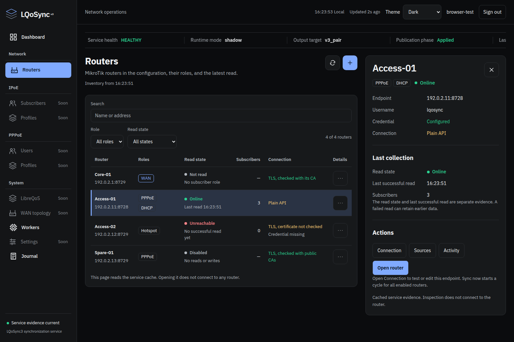

# Router reference layout evidence

Status: implemented and verified in the isolated Chromium fixture. Not installed in production.
Reference: [original Routers concept](../../images/02-routers.png).
Plan: [reference extraction and acceptance](../../plans/2026-11-21-router-reference-layout.md).

## Result and deliberate differences

The inventory stays on the left. Inspect opens the selected router on the right.
The selected row has a blue fill and an edge marker.
Close or Escape dismisses details and returns focus to the Inspect button.
A filter that excludes the selected router closes details.

The page retains the existing brand, semantic colors, font, routes, and filters.
The row name still opens the complete router page.
Connection, Sources, Activity, and Open router use existing detail routes.
The approved Add and Sync icons remain in the toolbar. Add uses the existing modal.

The concept's collection duration, interval, and message have no current DTO fields.
This implementation shows the available read state and last successful read separately.
It shows credential status and the username, with no password value.
The common Sync control starts a cycle for all enabled routers.
The summary directs the operator to Connection for the existing test and edit controls.

Below 1200px, details stack under the inventory.
All table columns remain available through a named local scroll region.
This changes the previous mobile layout, which hid several columns.

## Verification scope

`tools/frontend/routers-layout-check.cjs` uses the isolated browser fixture.
Its assertions cover selection, focus, close, filters, disabled/failed states, themes, routes, and 320–1536px layouts.
It also asserts that inspection sends no write request.
Existing router browser checks cover registration, edits, source lists, Sync, and connection tests.

The pictures contain synthetic fixture records. They do not show production routers.
No production service, configuration, or router changed.

## Guidance

[Vercel frontend-design](https://github.com/vercel-labs/open-agents/blob/main/.agents/skills/frontend-design/SKILL.md) informed the controlled density and table/details composition.
[Google Modern Web Guidance](https://github.com/GoogleChrome/modern-web-guidance) supplied `responsive-table`.
The implementation retains semantic headers, a sticky row header, and a named keyboard-scroll region.
Container queries adapt the filters to the inventory column's width.
The optional UI/UX inspector scripts are absent. Playwright supplies the browser checks and screenshots.

## Screenshots

| View | Picture |
|---|---|
| Desktop dark | [1536px](desktop-dark.png) |
| Desktop light | [1536px](desktop-light.png) |
| Small laptop | [1280px](layout-1280.png) |
| Mobile | [390px](layout-390.png) |
| Narrow mobile | [320px](layout-320.png) |

## Completed checks

- Release Wasm build and distribution preparation passed.
- All 32 UI unit tests passed.
- Wasm Clippy with warnings denied passed.
- Formatting and whitespace checks passed.
- Five browser suites passed: layout, inventory/navigation, operations, edits, and source lists.
- Manual screenshot review covered dark, light, and narrow layouts.

The layout check covers 1536, 1280, 1024, 768, 390, and 320px viewports.
The browser checks use Chromium. Firefox, WebKit, and a live screen reader were not run.
The optional design inspector is absent. No inspector result is claimed.

Reproduce the browser checks with the isolated fixture on loopback port 19581.
Set `PLAYWRIGHT_MODULE`, `CHROMIUM_PATH`, `BROWSER_TEST_PASSWORD`, and `ROUTERS_EVIDENCE_DIR` for that fixture.
Run `node tools/frontend/routers-layout-check.cjs` after the fixture starts.
Use a fixture account password only.
