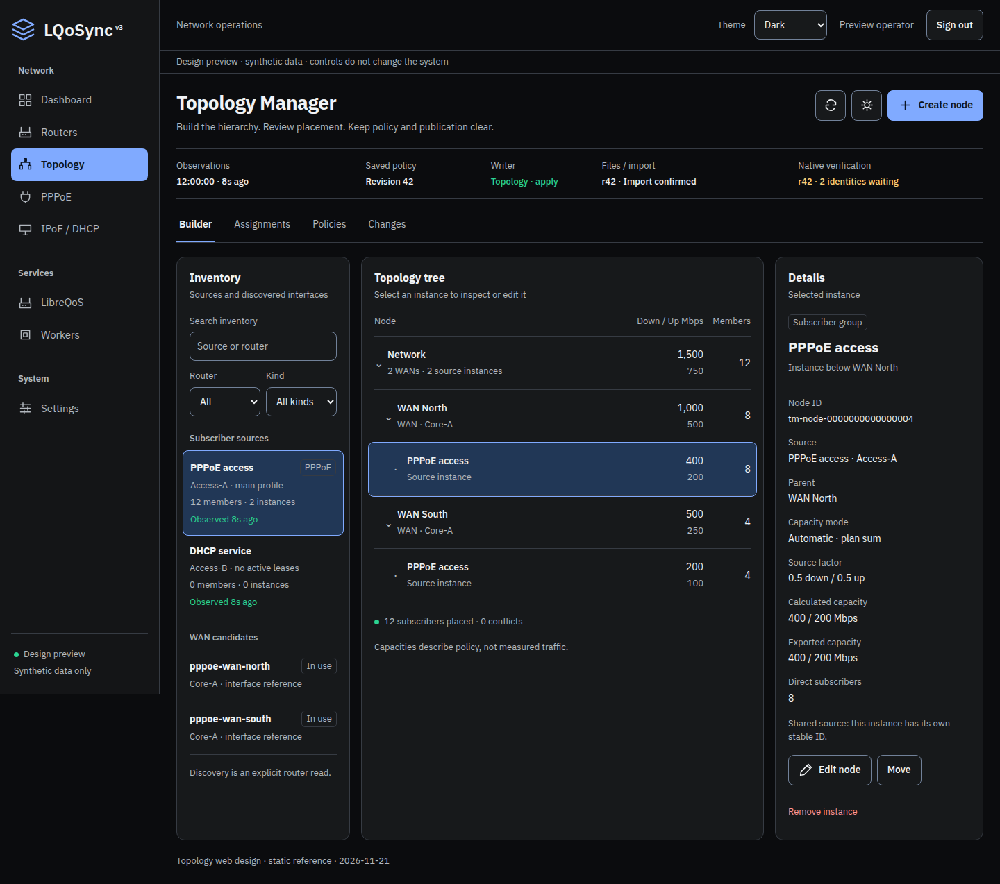

# Topology Manager mockups and design evidence

Status: static design references for review. This task does not implement the Topology web application.
Date: 2026-11-21, Asia/Shanghai. Source checkpoint: `76563ee`.
Cross-check: `e17b3b8` has no change to the inspected topology, API, Runner, or web routing sources.

Read [the feature/layout design](../../TOPOLOGY_DESIGN.md), [the connection map](../../TOPOLOGY_CONNECTIONS.md), [the implementation plan](../../TOPOLOGY_IMPLEMENTATION_PLAN.md), and [the subscriber-view specification](../../TOPOLOGY_SUBSCRIBER_VIEWS.md).

## Visual references

| Picture | Intended reference |
|---|---|
| [Builder, dark](builder-dark.png) | Source inventory, hierarchy, selected instance, and shared evidence strip |
| [Builder, light](builder-light.png) | Same composition with light semantic tokens |
| [Assignments](assignments-dark.png) | Subscriber identity, placement, plans, and pins |
| [Policies](policies-dark.png) | Global speed rules, local plans, source factors, fallback, unavailable schedules |
| [Changes](changes-dark.png) | Critical conflict, web history, and separate publication evidence |
| [PPPoE Users](pppoe-dark.png) | Accounts, sessions, identity links, plan, and placement |
| [IPoE Clients](ipoe-dark.png) | DHCP lease states, historical evidence, and verified subscribers |
| [PPPoE Local plans](pppoe-plans-dark.png) | PPPoE membership in the shared plan catalog |
| [IPoE Local plans](ipoe-plans-dark.png) | DHCP membership and global unique impact |
| [PPPoE light](pppoe-light.png) / [IPoE light](ipoe-light.png) | Source-view light tokens |
| [PPPoE mobile](pppoe-mobile.png) / [IPoE mobile](ipoe-mobile.png) | Source tables with local scroll |
| [PPPoE 320px](pppoe-320.png) / [IPoE 320px](ipoe-320.png) | Narrow source-view layout |
| [PPPoE plans mobile](pppoe-plans-mobile.png) / [IPoE plans mobile](ipoe-plans-mobile.png) | Shared plan layouts on mobile |
| [Review](review-dark.png) | An edit-specific capacity review with explicit base revision |
| [Tablet](builder-tablet.png) | Two workspace columns and Details below |
| [Mobile Builder](builder-mobile.png) | One focused workspace panel with local panel selectors |
| [320px Builder](builder-320.png) | The narrowest initial reference |
| [Mobile Assignments](assignments-mobile.png) | A local table scroll region within a narrow page |
| [Mobile Policies](policies-mobile.png) | Stacked policy sections |
| [Mobile Changes](changes-mobile.png) | Stacked conflict and evidence sections |
| [Mobile Review](review-mobile.png) | A bounded capacity-review panel |



The pictures contain synthetic identities, counts, rates, timestamps, and publication states.
They do not show the operating network. The written contracts override any visual ambiguity.
Each scene can represent a separate fixture. Do not infer one live history from the picture order.

## Sample data and arithmetic

The Builder has two WANs: North at 1000/500 Mbps and South at 500/250 Mbps.
The root row summarizes their combined capacity. It is not a new registry node.
The capacity ratio is 2:1. One subscriber source has two distinct node instances.

Twelve subscribers each have a 100/50 Mbps local plan.

Their plan sum is 1200/600 Mbps. A source factor of 0.5 gives a 600/300 Mbps group budget.
North receives 400/200 Mbps and eight subscribers. South receives 200/100 Mbps and four subscribers.
The tree shows subtree member counts. Details shows the selected instance's direct count.

The Review proposes a source factor of 0.6.
The group budget becomes 720/360 Mbps. The instance capacities become 480/240 and 240/120 Mbps.
No subscriber changes destination. The review does not introduce an extra publication Apply gate.

The Changes fixture is independent. It illustrates observation growth against a fixed capacity.
Its affected instance has 45 members with 10/5 Mbps minimums and a fixed 400/200 Mbps capacity.
The total minimum is 450/225 Mbps, so publication stops.
Saved revision 43 does not replace the last written revision 42 merely because the UI loaded it.
The old receipt still has two identities that await native acceptance.

The source-view fixture is independent from Builder.
Three PPPoE subscribers and two DHCP subscribers use Access 100.
One subscriber has both identities, so the plan has four unique subscribers.
Both views select `sub-002` and show the same plan and pin.
Observation-only records have no policy actions. A stale DHCP address is labeled Past.

## Layout contract for coding

| Element | Reference |
|---|---|
| Application sidebar | 230px on desktop; preserve the current brand and route order |
| Workspace | 24px desktop padding; 16px narrow-screen padding |
| Builder columns | Inventory 250–260px, flexible Tree of at least 320px, Details 300px |
| Grid gaps | 16px |
| Base type | Local IBM Plex Sans; 15px body, 13px minimum readable labels |
| Page title | 28px desktop; 26px in this compact reference |
| Main actions | 44px minimum controls; icon names remain accessible |
| Surfaces | Dark `#0b0c0e` canvas and `#17191b` panels; semantic light equivalents |
| Accent | Dark `#80aaff`; light `#0865d9` |
| Hierarchy | Selected instance has a restrained blue fill and outline |
| Evidence | Observation time, saved revision, writer, file/import state, native verification |
| Breakpoints | Two Builder columns below 1250px viewport; one focused panel below 760px |

Production breakpoints must also account for the workspace container width, sidebar width, zoom, and text scale.
Do not compress panels below usable widths merely to preserve a three-column picture.
Preserve source IDs, instance IDs, policy units, counts, and evidence labels during implementation.

The static review uses a positioned HTML section for a picture only.
Production review must use a native modal dialog with the behavior in the design.
The compact panel selectors, forms, and operational buttons are visual references, not working production controls.
Only the static view links navigate between reference files.

## Reproduction and completed checks

The editable sources are [Builder HTML](mockup.html), [Assignments HTML](assignments.html), [Policies HTML](policies.html), [Changes HTML](changes.html), [Review HTML](review.html), [PPPoE Users](pppoe.html), [IPoE Clients](ipoe.html), [PPPoE plans](pppoe-plans.html), [IPoE plans](ipoe-plans.html), and [CSS](mockup.css).
No image-generation model produced these pictures. Chromium rendered the HTML/CSS with the repository's local font.
The mockups add no third-party image asset or runtime dependency.

Run the capture script with an installed Playwright module and Chromium executable:

```sh
node docs/frontend/evidence/topology-manager/capture.cjs
```

Set `PLAYWRIGHT_MODULE` and `CHROMIUM_PATH` when those tools are outside their normal locations.
The script uses local files only. It does not start a production service or request an account password.

The capture script records dimensions and checks in [capture-results.json](capture-results.json).
All 25 static captures passed. The subscriber extension adds 12 captures to the original 13.
The checks cover page overflow, the local font, title presence, the 13px text floor, and semantic color-token contrast.
Text tokens must meet 4.5:1. Control boundaries and focus tokens must meet 3:1.

Review images use the viewport. Other images include the full document, so their image height can exceed the viewport height.

These checks concern static references. They do not prove focus behavior, screen-reader output, data integrity, or runtime performance.
Production browser, transport, crash, and publication tests remain unchecked tasks in the implementation plan.
The optional UI/UX inspector scripts are absent. Playwright supplies the available static checks.

## Design guidance and STE review

[Vercel frontend-design](https://github.com/vercel-labs/open-agents/blob/main/.agents/skills/frontend-design/SKILL.md) supplied visual direction and controlled density.
The design preserves the current console instead of replacing its identity with a generic dashboard.

[Google Modern Web Guidance](https://github.com/GoogleChrome/modern-web-guidance) supplied the `responsive-table`, `tabs`, and `dialog` guidance.
Source-view destinations use navigation links, not ARIA tab roles.
The source tables preserve semantic headers and keyboard-scroll regions.
The table plan keeps semantic headers and a local scroll region.
The production modal plan uses `showModal()`, native focus behavior, and progressive scroll containment.
The static review picture does not claim to implement that modal behavior.

The STE review uses short sentences, active procedures, explicit states, and exact technical terms.
The bundled checker is heuristic. Its dictionary flags technical nouns and action names that need manual review.

Examples include Topology Manager, snapshot, broker, paging, Pending, Confirm, heading, and padding.
Confirm is the exact proposal action. Native verification is the exact acceptance concept.
Do not replace these terms with wording that changes their technical meaning.
No certified ASD-STE100 compliance claim follows from this review.

Read [the review report](review.md) for feature coverage, findings, and unresolved release conditions.

## Git handoff rule

The owner first required Claude Code processes to finish before commit/push.
The owner later authorized publication after the no-collision work-split note passes review.
The current [shared handoff](../../../../brain/HANDOFF.md) assigns Journal/Workers to Claude Code and Topology to Codex.
This publication contains only new Topology documents, static mockups, and the task's own session note.
It excludes shared source files and the other worker's uncommitted changes.

Check HEAD, index, active Git processes, and path ownership immediately before publication.
Use explicit paths and a normal fast-forward push. Do not terminate Claude Code or force a Git update.
A later code task must recheck the latest owner instructions and shared handoff.
