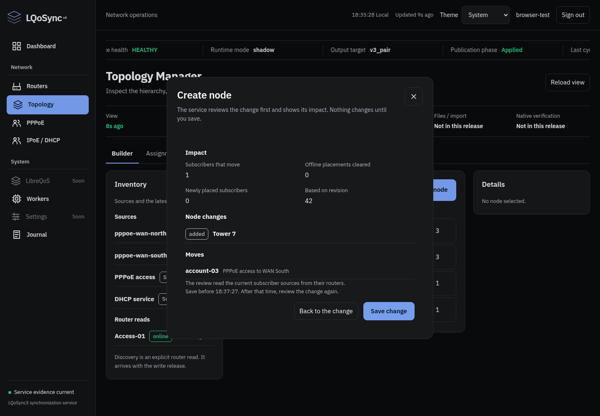

# Topology web views: read-only release (T00–T03)

Date: 2026-11-21, Asia/Manila. Plan: [TOPOLOGY_IMPLEMENTATION_PLAN.md](../../TOPOLOGY_IMPLEMENTATION_PLAN.md).
The screenshots contain synthetic fixture data only.

## Scope

This release adds these read-only views:

- Topology: Builder, Assignments, Policies, and Changes (`/topology?tab=...`).
- PPPoE: Users and Local plans (`/pppoe`, `/pppoe?view=plans`).
- IPoE / DHCP: Clients and Local plans (`/ipoe`, `/ipoe?view=plans`).

No view writes policy. No view reads a router. Write actions show an "arrives with the write release" note.

## Data path

1. At the end of each cycle, the service writes `topology.json` (mode 0600) beside `routers.json`.
   The file holds one snapshot: the registry revision, the cached preview, and the cycle collection.
2. The broker reads the file and answers one bounded reply (64 KiB or less).
3. The gateway serves these authenticated GET routes:
   - `GET /api/v1/topology`: evidence, tree, sources, plans, collection health, and counts.
   - `GET /api/v1/topology/assignments`: saved subscriber records, filtered, then paged.
   - `GET /api/v1/topology/observations`: PPP and DHCP rows, filtered, then paged.
   - `GET /api/v1/topology/subscribers/{id}`: one subscriber and its linked rows.

A cursor holds the snapshot ID, a filter digest, and an offset.
A cursor from another snapshot or filter gives `409`. The page then loads its first page again.

## Identity links

A PPP or DHCP row links to a saved subscriber only through the reference rule of its source:

- `PppSecretName`: `ppp-name/v1/<encoded secret name>`.
- `DhcpClientMac`: `dhcp-mac/v1/<normalized MAC>`.

The link state is `none` when no saved record has that reference.
The link state is `unknown` when the evidence cannot decide:

- The source uses `OperatorManagedComment`. The collection does not hold the comment.
- A PPP source has service-name filters. The collection does not hold the PPP service.
- More than one source selection matches the row.

The view never links a row by IP address, by MAC address alone, or by display name.
A failed router read makes the rows of that router `stale`.

## Checks

| Check | Result |
|---|---|
| `cargo test --locked --lib web_view` | 11 passed, including a 50,000-subscriber projection (145 ms release, 19.5 MB) |
| `cargo test --locked -p web-gateway --test topology` | 7 passed |
| `cargo test --locked -p web-gateway --test http` | Passed: 401, 503, 200, 404, 409, and 405 for POST |
| `cargo test --locked -p web-ui` | Route and model tests passed |
| `node tools/frontend/topology-check.cjs` | Passed in dark and light themes |

The browser check covers these items:

- Sidebar navigation and `aria-current`.
- The evidence strip.
- Tree order and node selection.
- Assignments filters and the subscriber deep link.
- PPPoE and IPoE rows, link filters, and observation-only rows.
- One subscriber with a PPPoE and a DHCP identity, which opens the same record from both views.
- Plan counts: source identities and unique subscribers stay separate.
- Widths of 320 px and 390 px with no page-level horizontal scroll.
- Only GET requests to the topology routes.

## Screenshots

- [Builder](topology-builder-dark.png)
- [PPPoE Users with the selected subscriber](pppoe-dark.png)
- [IPoE Local plans](ipoe-plans-dark.png)

## Limits of this release

- Files/import and native verification came in T10. See "Publication evidence (T10)" below.
- Speed defaults and source factors came in T09.
- The broker reads the whole cache on each request. Large networks can make reads slower.
- The summary keeps the first nodes that fit one reply and marks the rest as truncated.
- Refresh, discovery, edits, plans, pins, and rebalance came in T04–T09.

# Builder changes (T04–T06)

Date: 2026-11-21, Asia/Manila.

## Flow

1. The operator opens **Create node**, **Edit node**, **Move**, or **Remove node**.
2. **Review change** sends `POST /api/v1/topology/proposals`. The answer is `202` and an operation key.
3. The broker asks the service for a proposal. The operation becomes `review_ready` with an impact review:
   moves, cleared placements, node changes, warnings, and the expiry time.
4. **Save change** sends `POST /api/v1/topology/proposals/{key}/confirm` with a new receipt key.
   The broker sends the private service token. The browser never holds that token.
5. The page reads `GET /api/v1/topology/operations/{key}` until the state is final.
   **Saved** shows the policy revision. Publication follows in the next service cycle.

**Back to the change** and **Close** cancel the kept proposal. The draft stays in the form.

## Safety rules

- Every change needs the same origin, a current session, and the CSRF token.
- The actor comes from the session. A proposal of one actor cannot be confirmed by another.
- The same receipt key gives the same receipt. The service commits once per key.
- A reply lost after the request left is never sent again. The status asks the service receipt.
- Recovery after a crash decides from the registry only:
  - Still at the base revision: `not_committed`.
  - The prepared revision and the same document fingerprint: `saved`.
  - Anything else: `outcome_unknown`.
- Changes are off when the registry is absent, not enrolled, or the writer is unknown.

## Design guidance used

- Vercel frontend-design (`~/.agents/skills/frontend-design/SKILL.md`):
  - The page keeps the existing visual system.
  - One action keeps one name: **Review change**, then **Save change**, then "Saved".
  - Error texts say what to do next.
- Google Modern Web Guidance (github.com/GoogleChrome/modern-web-guidance):
  - `ui-components/dialog.md`: the dialog opens with `showModal()` and has `aria-labelledby`. It has no custom focus trap and no Escape handler. The browser returns focus to the button that opened the dialog.
  - `forms/validate-input-after-interaction.md` and `forms/required-field-feedback.md`: the form uses native `required`, `min`, and `max`, and `:user-invalid` styling. The submit button stays enabled during input.
  - `accessibility/accessible-error-announcement.md`: one polite status region and one alert for failures.

## Checks

| Check | Result |
|---|---|
| `cargo test --lib web_receipts` | 9 passed: crash before the write, crash after the write, later commit, key reuse, foreign actor, pruning |
| Runner API tests | One commit per key, failed receipt on a stale revision, and recovery at restart |
| `cargo test -p web-gateway --test topology_jobs` | 8 passed: deduplication, lost reply, queue limit, proposal lease, expiry, cancel, service rule text |
| `edits_tests::every_web_builder_edit_is_a_service_edit` | Each web edit parses as a service edit |
| `topology-check.cjs` | Review and save, Escape, focus return, `:user-invalid`, and only the proposal and confirm POSTs |

# Publication evidence (T10)

Date: 2026-11-21, Asia/Manila.

The view carries the latest shaping write from `write-receipt.json`:

- The write ID and phase.
- File names and their outcomes. Paths and error texts stay in the service journal.
- Native acceptance.
- The published policy revision. A legacy writer write has no revision.

The evidence strip shows three separate facts:

| Item | Source | Example |
|---|---|---|
| Saved policy | Registry revision | Revision 42 |
| Files / import | Write phase | r42 · import confirmed |
| Native verification | Write phase and acceptance | r42 · waiting |

An imported write is not applied until the native runtime accepts it.
When the saved revision is newer than the published revision, a note says so.
A legacy write says that it publishes no topology revision.

Changes shows the latest write and the web change history.
The history lists only changes saved from the web page. TUI and CLI changes are not in it.
A Builder save shows as "Reviewed change", because the receipt keeps only the private proposal token.
