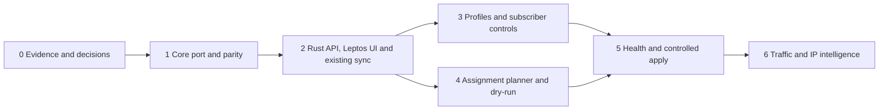

# LQoSync4 delivery roadmap

**State:** planning. The checkout contains the LQoSync3 Rust core. It does not contain the LQoSync4 HTTP API or Leptos application. This roadmap assigns future work to roles; it does not claim that agents have completed those tasks.

## Agent entry and source order

1. Read root [AGENTS.md](../../AGENTS.md), the [brain handoff](brain/HANDOFF.md), [decisions](brain/DECISIONS.md), [agent workflow](brain/AGENT_WORKFLOW.md), and [completion gate](brain/PRODUCTION_READY_GATE.md).
2. Query the [planning graph](graphify-out/README.md). Confirm important claims in Rust source and the linked specs. A graph node is not proof of implementation.
3. Select one task ID below. Record its dependencies, owner role, files to own, and acceptance evidence in the handoff format. Do not edit a file owned by another active agent.
4. Complete the task's vertical path: input, validation, state, background job, external effect, readback, API result, UI state, and audit where applicable. A task can be completed only after the applicable [production gate](brain/PRODUCTION_READY_GATE.md) passes.

Use the [product spec](docs/PRODUCT_SPEC.md) for behavior, [feature/function map](docs/FEATURE_FUNCTION_MAP.md) for existing source and proposed functions, [route/component contract](docs/ROUTES_AND_COMPONENTS.md) for navigation and API shape, [visual system](docs/UI_VISUAL_SYSTEM.md) for layout, [v3 data flow](docs/LIBREQOS_V3_DATA_FLOW.md) for shaping, and [controlled requirements](ste/REQUIREMENTS.md) for stable requirement IDs. Proposed names and routes remain proposals until an implementation task freezes their contract.

## Ownership lanes

| Lane | Owns | Boundary |
|---|---|---|
| Coordinator | Scope, task order, decisions, integration, final evidence | Does not silently close an open owner decision. |
| Mapper | Existing source trace, Graphify links, requirements trace | Reports facts and gaps; does not mark planned code implemented. |
| Core backend | RouterOS collection, identity, shaping, profile and assignment logic, health, writer | All operational logic is Rust. |
| Middle layer | Persistent models, Rust API, DTOs, auth, jobs, snapshots, audit | HTTP never starts a RouterOS scan or applies a write inline. |
| Frontend | Leptos routes, components, CSS, browser states | No hand-written JavaScript or TypeScript application logic. |
| Verifier | Contract, failure, restart, browser, performance, and diff review | Reviews actual code and test results independently when an agent is available. |

One agent may perform several lanes in sequence. Parallel agents own different files. The coordinator integrates contracts before either side assumes a DTO or endpoint shape. Every task handoff records: task ID; branch and base commit; owned files; existing behavior; accepted and open decisions; implementation; commands and results; risks; next action.

## Phase sequence and release gates

| Phase | Main deliverable | Gate |
|---|---|---|
| [0 — Evidence and contracts](roadmap/00-evidence.md) | Reproducible baseline, sample data, decision ledger, frozen first-slice contracts | No unsupported implementation assumption. |
| [1 — Core port](roadmap/01-core-port.md) | TUI-free Rust core with LQoSync3 LibreQoS parity | Shadow/apply, target, backup, and recovery regression proof. |
| [2 — Web foundation](roadmap/02-web-foundation.md) | Authenticated Rust API, Leptos routes, router/admin actions and existing LibreQoS sync | All phase-2 routes show real data and correct action/freshness states. |
| [3 — Profiles and subscriber control](roadmap/03-profiles.md) | IPoE/PPPoE profiles, schedule, effective-speed preview and approved actions | Time, priority, restart, and external-effect tests. |
| [4 — WAN assignment planning](roadmap/04-assignment.md) | Stable percentage/count/manual planner and logical assignment dry-run UI | Deterministic plan, explainable logical diff, 1k/10k measurements. |
| [5 — Health and apply](roadmap/05-health-apply.md) | Health state machine and controlled RouterOS reconciliation | Failure/recovery/partial-write simulations and readback. |
| [6 — Telemetry and intelligence](roadmap/06-telemetry.md) | Traffic history first; destination IP intelligence after source/privacy decisions | Freshness, accuracy, retention, and load evidence. |

Phases 3 and 4 can run in separate file lanes after phase 2 contracts are frozen. Phase 5 consumes both. Deployment and live RouterOS writes require the applicable owner authorization; a successful simulation is not a production deployment.

## Decision gates

| Gate | Needed before | Owner decision or evidence | Independent work meanwhile |
|---|---|---|---|
| G0 | Freeze phase 2 persistence/API | Backend HTTP framework, persistent store, auth/session policy and role matrix | Core parity fixtures, UI shell, DTO proposal. |
| G1 | Phase 3 external profile writes | Exact profile-specific RouterOS/LibreQoS objects, write mechanism, readback and conflict rule | Pure schedule resolver, preview, UI with explicit pending state. |
| G2 | Phase 5 WAN RouterOS writer and exact object diff | Exact WAN writable objects, core-router topology, rollback and credentials contract | Logical assignment planner and simulated readback. |
| G3 | Automatic failover/failback | Health source and thresholds, manual-pin outage policy, automatic-apply and failback policy | Health state machine with injected samples; shadow plans. |
| G4 | Destination observations | Source, IPv4/IPv6 identity, access policy, retention and accuracy method | Aggregate traffic history with no app labels. |

These are open in [DECISIONS](brain/DECISIONS.md). An agent records a proposal and owner evidence there before treating a gate as resolved. The user already accepted Rust backend, Leptos/Wasm frontend, and MikroTik core ownership of routing. Public-IP change and session interruption on failover are acceptable.

## Shared proof and traceability

| Requirement IDs | Primary tasks | Required proof |
|---|---|---|
| CORE-01, CORE-02, CORE-03, CORE-04, CORE-05, CORE-06, CORE-07, CORE-08, CORE-09 | E01, C01…C03, W01…W06 | Existing-source baseline; output parity; Rust/Leptos build. |
| UI-01, UI-02, UI-03, UI-04, UI-05, UI-06, UI-07, UI-08, UI-09, UI-10, UI-11, UI-12, UI-13, UI-14 | W02…W07, P03, A03, H03 | Desktop, phone, 200% zoom, keyboard and operational-state checks. |
| PERF-01, PERF-02, PERF-03, PERF-04, PERF-05, PERF-06, PERF-07, PERF-08, PERF-09, PERF-10 | E03, C02, W01…W06, A02, T01 | Slow-router and 1k/10k workloads; bounded queues, DOM and API payloads. |
| WAN-01, WAN-02, WAN-03, WAN-04, WAN-05, WAN-06 | A01…A03, H01…H03 | Deterministic simulation, dry-run diff, readback and audit. |
| PROF-01, PROF-02, PROF-03 | P01…P03 | Schedule boundary, overlap, effective-source and write-result checks. |
| SAFE-01, SAFE-02 | W01, W03, W05…W07, P02, H02 | Unauthorized mutation, effective-config and secret-redaction checks. |
| IP-01, IP-02, IP-03 | T02…T03 | Time-correlated observation, enrichment, confidence/unknown checks. |

For every task, record **implemented**, **compiled**, **tested**, **benchmarked**, and **production-like verified** separately. Do not infer one from another. Numerical performance budgets follow representative baseline measurements; the 1,000-subscriber and 10,000-subscriber sets are workloads, not capacity promises.
