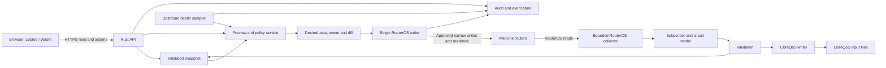
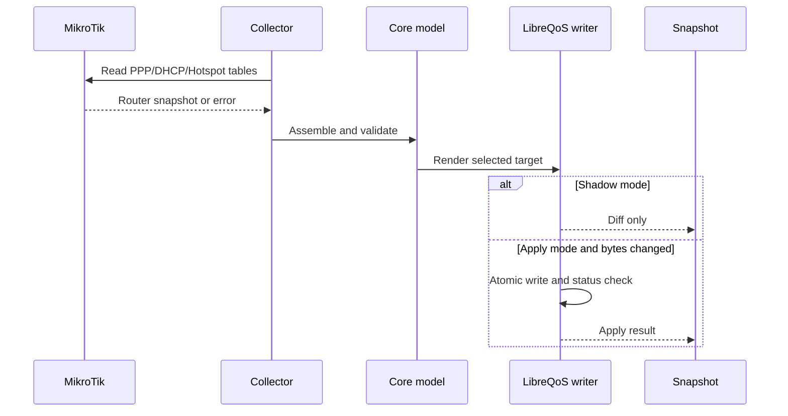
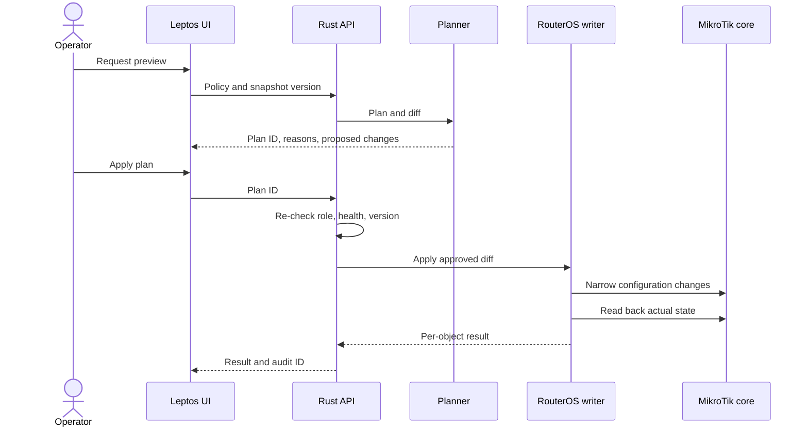
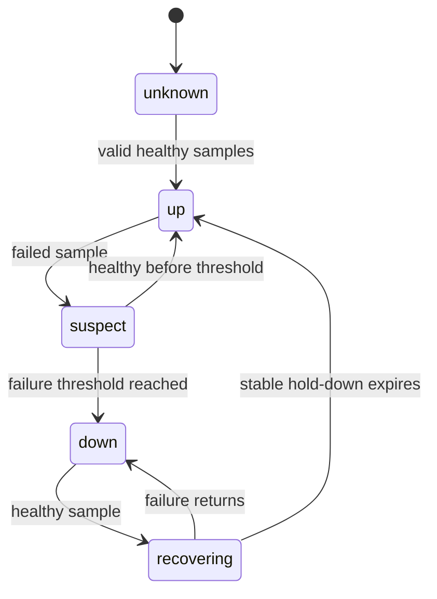

# LQoSync4 architecture and workflows — proposed

The diagrams describe design boundaries. The existing source currently implements the left RouterOS read to LibreQoS shaping path only. Modules on the right are proposed.

## Component map

Caption: The API serves snapshots. The collector and writers run outside request handlers. The core router owns routing and session behavior after an assignment change.

## Workflow 1 — subscriber and LibreQoS sync

1. The collector reads enabled RouterOS tables with bounded timeouts and retries.
2. The core assembles one circuit model and validates it.
3. The target detector selects the LibreQoS format.
4. Shadow mode writes candidate files. Apply mode backs up changed live files and writes only changed bytes. The v3 pair path checks LibreQoS import; native JSON acceptance needs a separate check.
5. The snapshot publisher records written and imported states separately, with version, time, and errors. See [the exact v3 data flow](LIBREQOS_V3_DATA_FLOW.md).

## Workflow 2 — operator reads and changes an assignment

1. The browser reads a versioned operational snapshot and a paged assignment list.
2. The operator selects a policy or subscriber move and requests a preview.
3. The planner calculates the desired assignment and a RouterOS diff. It shows the reason for each move.
4. The operator applies the plan. The server re-checks identity, permissions, health, and snapshot version.
5. One writer applies the approved RouterOS objects, reads them back, and records the result.
6. The UI reads the new snapshot or receives a changed-record event.

## Workflow 3 — upstream failure and recovery

- A health sampler changes an upstream to `down` only after the configured failure threshold. `unknown` and stale data do not automatically mean `down`.
- The planner excludes a down upstream and proposes moves for affected subscribers. A policy decision will define whether this is auto-applied or requires operator approval.
- A recovered upstream returns to the pool only after a stable hold-down period. The failback policy decides whether existing subscribers move back.
- MikroTik core handles traffic routing and sessions after a move.

## Workflow 4 — scheduled profile override

The scheduler evaluates local days and time windows in a configured timezone. It chooses the highest-priority active override. It calculates the effective speed and previews affected subscribers before a router or shaping change. A restart must recompute the same effective speed from persisted rules.

## Later workflow — IP intelligence

Telemetry links a subscriber to destination IP, time, and bytes. An enrichment cache adds ASN and organization. A classifier may add CDN and app labels with evidence and confidence. The UI shows `unknown` when evidence is insufficient. Retention and access limits require an owner decision before collection begins.
