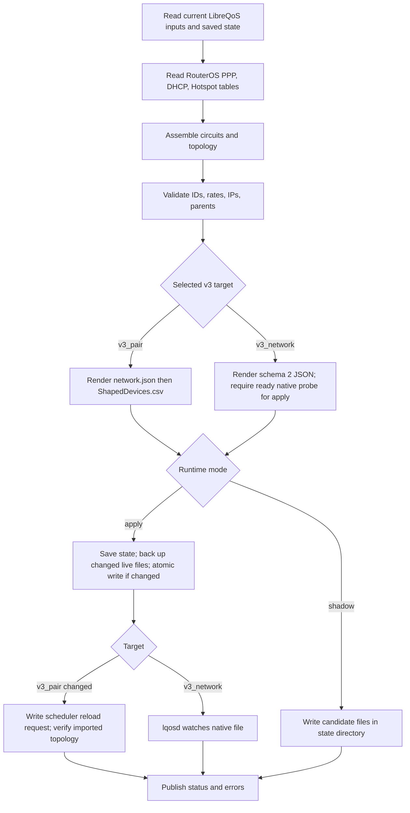

# LibreQoS v3 input and update map

This map describes the existing LQoSync3 code on the `lqosync4` branch. It is the contract to retain when the LQoSync4 backend replaces the TUI. It does not imply that the new API or Leptos page exists. [LibreQoS v3 ingress evidence](../../LIBREQOS-V3-INGRESS.md) records the observed behavior and its limits.

## WHAT is written, and WHEN?

| LibreQoS v3 source | LQoSync target | Source files owned by LQoSync | Import path | Current evidence |
|---|---|---|---|---|
| `[topology] source = "shaped_devices"` | `v3_pair` | `ShapedDevices.csv` (15 columns, including `Anchor Node ID`) and `network.json` | LQoSync writes both files, requests scheduler reload, then checks imported topology | Live input, import, and runtime state were checked. |
| `[topology] source = "libreqos_network"` | `v3_network` | `libreqos_network.json` (schema 2) only | `lqosd` watches the native JSON file | Offline compiler evidence only. Native node-rate loss blocks a production switch until the installed probe passes. |

`detect::resolve` reads the installed LibreQoS package version and v3 `lqos.conf` topology source on every cycle. A fixed target in LQoSync configuration bypasses automatic selection. Other v3 topology sources are rejected because LibreQoS owns their input. See [`detect.rs`](../../../src/detect.rs) and [configuration](../../CONFIGURATION.md).

## HOW does one cycle update the source?

1. [`runner::cycle_inputs`](../../../src/runner.rs) reads the current CSV, selected network tree, and `state.json`. [`routeros::read_router`](../../../src/routeros.rs) reads each configured router. [`cycle::assemble`](../../../src/cycle.rs) builds rows and topology, then calls [`validate::check`](../../../src/validate.rs).
2. For `v3_pair`, [`writer::pair::render_network_json` and `render_csv`](../../../src/writer/pair.rs) render the tree first and the 15-column CSV second. For `v3_network`, [`writer::v3network::render_libreqos_network`](../../../src/writer/v3network.rs) renders schema 2 with `topology`, `circuits`, `devices`, IP prefixes, and rates. A skipped circuit produces an alert.
3. Shadow mode writes to `<state_dir>/candidate/`. Apply mode writes to the LibreQoS source directory. Before changed live files are written, [`runner::cycle_inner`](../../../src/runner.rs) saves state and backs up existing target files. [`files::write_if_changed`](../../../src/files.rs) uses a temporary file, sync, and rename; unchanged bytes cause no write. The two pair files are replaced individually, so the pair is **not one atomic transaction**.
4. On a changed `v3_pair`, the runner writes `<libreqos.state_directory>/scheduler/reload_request.json`. The scheduler imports the pair into `topology/topology_import.json`. [`files::imported`](../../../src/files.rs) compares imported circuits, devices, parents, maximum rates, and the compatibility network tree with the desired source. The runner retains an `import-pending` marker until they agree; after the configured wait limit it reports an error. This reload-request file is a LibreQoS internal interface and may change after an upgrade.
5. On `v3_network`, apply is blocked until [`probe::status`](../../../src/probe.rs) reports ready. The runner writes only the native JSON. `lqosd` watches it; the current runner does **not** perform the pair-style imported-content check for this target. A successful file write therefore does not prove that the native topology was accepted.

## LQoSync4 backend and UI mapping — proposed

| Layer | Responsibility | Required UI state |
|---|---|---|
| Collector and core | Reuse RouterOS reads, identity/state reconciliation, assembly, and validation. | Last collection time, router errors, number of validated and skipped circuits. |
| Target adapter | Run detection and the native probe; expose selected source and why. | `v3_pair` or `v3_network`, probe result, source mismatch warning. |
| Shaping writer | Keep one serialized apply cycle, backup, changed-byte writes, and import marker. | Preview before apply; candidate versus live diff; file generation and backup ID. |
| Import observer | For `v3_pair`, compare imported topology. For native JSON, define a reliable accepted-generation check before claiming `applied`. | `candidate`, `written`, `import pending`, `imported`, `error`, with timestamps. |
| Rust API and Leptos | Serve cached status and paged preview. Trigger a background sync job; do not perform router reads or file writes in an HTTP handler. | LibreQoS page with target, source files, rows, alerts, import state, and last error. |

**Implementation gates:** preserve v3 pair output parity; test shadow/apply and unchanged writes; test interrupted two-file updates and recovery; test delayed/rejected imports; and keep the native target disabled for production until node rates and accepted-generation checks pass. The UI must label `written` and `imported` separately.
