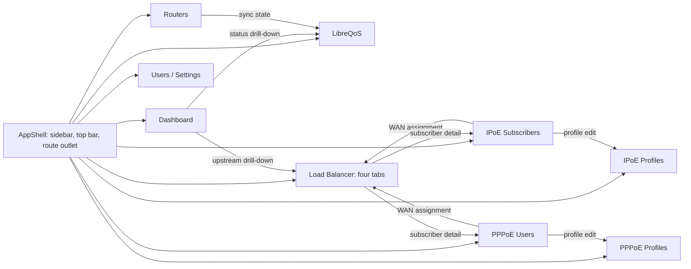

# LQoSync4 routes and component contract — proposed

This document maps the screenshot references to Leptos pages, child components, Rust API reads, background jobs, and navigation. It is a design contract; no LQoSync4 web route or API exists yet. The [product spec](PRODUCT_SPEC.md) defines behavior, the [feature/function map](FEATURE_FUNCTION_MAP.md) identifies backend owners, and the [LibreQoS v3 map](LIBREQOS_V3_DATA_FLOW.md) defines the existing shaping path.

## Route rules and shared shell

- Browser routes are Leptos routes. API paths are server routes under `/api/v1`. Path names below are proposed and must be frozen before implementation.
- The sidebar keeps the screenshot order: Dashboard, Routers; IPoE Subscribers and Profiles; PPPoE Users and Profiles; LibreQoS, Load Balancer, Users, Settings. The dark sidebar stays visible on desktop and becomes a navigation drawer on small screens. The slim top bar contains local time, data freshness, account menu, and theme control. Theme is a UI setting, not an operational action.
- `AppShell` owns `SidebarNav`, `TopBar`, `RouteOutlet`, `ToastRegion`, and `ActionDialogHost`. `RouteOutlet` changes pages; shell components must not fetch subscriber tables. `RouteError` distinguishes permission failure, unavailable data, and route not found.
- All operational cards use `StatusBadge`, `DataAge`, `EmptyState`, and `ErrorNotice`. A green status requires fresh evidence; stale or unknown uses a separate state. Tables share `TableToolbar`, `PageControls`, `SortHeader`, and `RowActionMenu`. Long tables use server paging and visible-row rendering; key actions remain reachable during horizontal scrolling.
- Reads come from cached, versioned backend snapshots. Mutations require role checks, a preview when they affect RouterOS or LibreQoS, an explicit apply step, and an audit result. A pending action never appears as applied. URLs contain search, filter, page, tab, and time-window state when a view benefits from a shareable link. Secrets never enter URLs.

## Route registry and deep links

| Browser route | Sidebar label / view | Read model | Main user action | Connected route |
|---|---|---|---|---|
| `/` | Dashboard | Overview, bucketed traffic, health, allocation summary | Select time window; open status detail | `/libreqos`, `/load-balancer`, `/routers` |
| `/routers` | Routers | Paged core/access router list and latest collection state | Add/test router; request read-only sync | `/libreqos`, filtered subscriber list |
| `/ipoe/subscribers` | Subscribers | Paged IPoE identities, authorization, profile, online state | Authorize, choose profile, inspect detail | `/ipoe/profiles`, `/load-balancer?tab=assignments` |
| `/ipoe/profiles` | Profiles | IPoE baseline and schedule rules | Create/edit baseline or schedule | `/ipoe/subscribers?profile=...` |
| `/pppoe/users` | PPPoE Users | Paged PPPoE users, router, profile, effective speed | Change profile, override speed, inspect detail | `/pppoe/profiles`, `/load-balancer?tab=assignments` |
| `/pppoe/profiles` | PPPoE Profiles | Router-filtered PPPoE profiles, counts, schedules | Edit or sync selected router profiles | `/pppoe/users?profile=...` |
| `/libreqos` | LibreQoS | Target, source files, last sync/import, rows, preview | Preview, request sync, inspect failure | `/routers`, subscriber lists |
| `/load-balancer` | Load Balancer | Summary, allocations, assignments, discovery, history | Preview policy/move; apply approved plan | Subscriber lists, `/` |
| `/users` | Users | Users, roles, access status | Invite/change role/disable, subject to policy | `/settings` |
| `/settings` | Settings | Safe configuration and integration status | Edit allowed config; test integration | `/routers`, `/libreqos` |

`/load-balancer?tab=allocations|assignments|discovery|history` is one page with shareable tabs. Subscriber and router detail can start as a drawer with `?id=`; the ID is opaque and validated by the server. Add a dedicated detail route only if the drawer cannot support direct links or browser back behavior. `/traffic-intelligence` is a later roadmap route and is absent from the first navigation release.

## Page and child-component breakdown

| Page | Placement from reference | Child components and responsibility | Backend reads and jobs |
|---|---|---|---|
| `DashboardPage` | Summary cards first; traffic and allocation charts second; UptimeRobot-style health grid and load-balancer table below. | `SummaryCards` owns subscriber/router/LibreQoS counts; `TrafficChart` owns window selection and bucketed series; `AllocationBreakdown` owns share/utilization; `HealthGrid` shows age and health; `AllocationSummaryTable` links each WAN to assignments. | `GET /overview`, `/traffic?window=`, `/upstreams`, `/allocations/summary`. Health source may be UptimeRobot or another approved monitor; do not hard-code the vendor. |
| `RoutersPage` | Header and core/access router list. | `RouterTable` shows role, address label, online state and last read; `RouterDetailDrawer` shows read status/errors and safe config; `RouterForm` collects connection settings; `ConnectionTestPanel` shows a test result. | `GET /routers`, `GET /routers/{id}`; test and sync start bounded background jobs. No credentials in reads. |
| `IpoeSubscribersPage` | Dense searchable list beneath a compact filter bar. | `SubscriberTable` shows identity, MAC/IP, router, authorization, profile, online and WAN; `SubscriberDetailDrawer` shows source and observation time; `AuthorizationPanel` previews grant/revoke; `ProfilePicker` selects IPoE profile. | `GET /subscribers?kind=ipoe&...`; authorization and profile actions go through policy preview/apply. Discovery is a collector job, not an HTTP scan. |
| `IpoeProfilesPage` | Vertical profile cards; expanded card has inline schedule editor. | `ProfileCards` show name, baseline down/up, subscriber count; `BaselineEditor` edits rates; `ScheduleTable` lists days/window/rates/priority; `ScheduleEditor` previews effective speed and conflicts. | `GET /profiles?kind=ipoe`; profile/schedule preview and versioned mutation. |
| `PppoeUsersPage` | Wide table with router, profile select, speed, override, status, last seen and row actions. | `PppoeUserTable` owns search, router filter and paging; `ProfilePicker` shows assigned profile; `EffectiveSpeedCell` shows scheduled/manual source; `SpeedOverrideDialog` previews change; `UserDetailDrawer` shows sync source and WAN. | `GET /subscribers?kind=pppoe&...`; profile/override actions. Router sync is a background job. |
| `PppoeProfilesPage` | Router filter and Sync All above profile cards. | `RouterFilter`, `ProfileCards`, `ProfileEditor`, `ScheduleEditor`, `SyncResultPanel`. Each card shows owning router, user count and effective rules. | `GET /profiles?kind=pppoe&router_id=`; profile actions and router-profile sync job. |
| `LibreQosPage` | Last-sync card, local/remote sync card, then scrollable input preview. | `TargetStatus` shows `v3_pair` or `v3_network` and probe; `SyncStatus` separates candidate/written/imported/error; `RemoteSyncStatus` appears only when configured; `SourcePreview` selects CSV+network tree or native JSON; `SyncHistory` lists runs and alerts. | `GET /libreqos/status`, `/libreqos/preview`, `/libreqos/runs`; `POST /libreqos/sync-jobs` queues a job. Native accepted-generation verification is an open gate. |
| `LoadBalancerPage` | Title/status and summary cards; tabs below; allocation cards or assignment table in content area. | `BalancerSummary` shows qualified/allocated/unallocated/core; `AllocationCards` show WAN capacity, members, target, RX/TX, health and actions; `AssignmentsTab` has search/filter/paging and `AssignmentRow` with manual pin/move; `DiscoveryTab` shows unallocated/unknown candidates; `HistoryTab` shows plan, health and apply events; `PlanPreviewDialog` shows every proposed RouterOS object change. | `GET /balancers/{id}`, `/allocations`, `/assignments`, `/discovery`, `/history`; preview/apply via versioned plan jobs. The core-router write contract remains open. |
| `UsersPage` | Admin table in the common shell. | `UserTable`, `RoleEditor`, `AccessStatus`, `AuditLink`. | `GET /users`, user mutation endpoints; backend checks role on every write. |
| `SettingsPage` | Grouped cards in the common shell. | `GeneralSettings`, `MonitorSettings`, `LibreQosSettings`, `SecuritySettings`, `IntegrationTestPanel`. Secrets are write-only or masked. | `GET /settings` returns safe fields; versioned updates and test jobs. Exact settings follow approved config ownership. |

The page entries name UI responsibilities, not Rust modules that already exist. Reuse shared table, status, and dialog components; keep domain-specific rate, assignment, and import logic on the server.

## Component-to-action contract

| Component/action | Intent and required input | Server result | UI transition |
|---|---|---|---|
| `RouterForm` / save | Role, endpoint, credential reference, expected version | Saved router ID or validation error | Return to router list; show test separately. |
| `AuthorizationPanel` / apply | Subscriber ID, desired authorization, reviewed version | Job ID and audited result | Show pending, then observed state. |
| `ProfileEditor` / save | Profile ID, baseline/schedule, timezone, reviewed version | Rule version and affected count | Refresh card and affected user links. |
| `SpeedOverrideDialog` / apply | PPPoE user ID, rates, duration or clear, reviewed version | Job ID and effective speed result | Show rule source in `EffectiveSpeedCell`. |
| `SourcePreview` / sync | Selected target and snapshot version | Preview or sync job ID | Show candidate, written, imported separately. |
| `AllocationCards` / edit | WAN ID, percentage or fixed count, capacity, reviewed version | Plan ID, changed subscribers, RouterOS diff | Open `PlanPreviewDialog`; apply only after review. |
| `AssignmentRow` / move or pin | Subscriber ID, WAN ID, pin flag, reviewed version | Plan ID, reason and diff | Show pending then desired/observed/applied WAN. |
| `HistoryTab` / open event | Audit event ID | Actor, reason, before/after, readback | Link to affected subscriber or allocation. |

All mutation results need a stable job or plan ID, explicit error code, audit ID where applicable, and a way to refresh the affected read model. A rejected stale version returns the current version and requires a new preview. Forms validate on both browser and server; server validation is authoritative.

## Navigation and ownership checks

1. Dashboard summary cards link to the corresponding filtered list. Health/allocator summaries link to the matching load-balancer tab and WAN filter.
2. A subscriber row links to its profile and assignment. An assignment row links back to the same subscriber ID and source-kind list.
3. A router detail links to subscribers observed on that router and to the LibreQoS run that consumed its latest snapshot.
4. A profile card links to members filtered by profile ID. A schedule change shows the number of affected members before apply.
5. The LibreQoS page links a rejected circuit to its subscriber or source record when identity is known. An unknown circuit stays visible with the validation error.
6. After a mutation, the page uses the job result and a fresh snapshot. It never infers success from a button click or file write alone.

## Review gaps before implementation

The reference images show layouts and actions but do not establish API contracts. RouterOS writable objects, role matrix, credential storage, monitor source, remote LibreQoS sync contract, exact profile enforcement path, native JSON acceptance check, and failback policy remain open. Do not treat those UI controls as functional until their server contract and readback are defined. The implementation plan should deliver read views first, then each write action with its preview, authorization, audit, and test gate.
